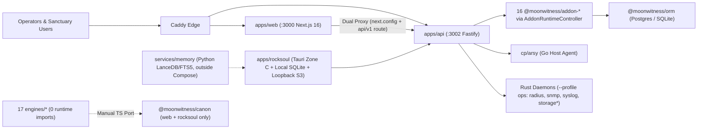

# MoonWitness Platform Architecture & Ecosystem Readiness Audit

> **Audit Scope & Baseline (2026-11-18):** Code- and test-verified audit on branch `dev` at commit `5c38909019d1034fb671bd64344dc35b16bd29a4` (with `0` staged, `54` unstaged, and `43` untracked pre-existing local workspace items preserved untouched). Read-only runtime scope: zero runtime code, database schemas, dependencies, or Tier 0 A-L-L-A-H canon (`docs/constitution/**`) modified.

## Companion Deliverables

- **Component Inventory JSON:** [PLATFORM-COMPONENT-INVENTORY.json](./PLATFORM-COMPONENT-INVENTORY.json)
- **Application Integration Matrix:** [APPLICATION-INTEGRATION-MATRIX.md](./APPLICATION-INTEGRATION-MATRIX.md)
- **Engine, Package & Addon Integration Matrix:** [ENGINE-PACKAGE-INTEGRATION-MATRIX.md](./ENGINE-PACKAGE-INTEGRATION-MATRIX.md)
- **Hybrid Mini-PaaS Readiness Assessment:** [HYBRID-PAAS-READINESS-ASSESSMENT.md](./HYBRID-PAAS-READINESS-ASSESSMENT.md)
- **Target Architecture Specification:** [PLATFORM-TARGET-ARCHITECTURE.md](./PLATFORM-TARGET-ARCHITECTURE.md)
- **Prioritized Engineering Roadmap (P0–P3):** [PLATFORM-ENGINEERING-ROADMAP.md](./PLATFORM-ENGINEERING-ROADMAP.md)

## 1. Executive Synthesis & Ecosystem Boundary

MoonWitness is one product platform inside the broader `A-L-L-A-H` ecosystem, organized around the three-app Trust Zone topology in [ADR-006](./adr-006-three-app-topology-and-trust-zones.md) and desktop local boundaries in [ADR-007](./adr-007-rocksoul-local-execution-and-data-boundary.md):

1. **Actual Platform Maturity:** **Production-Capable Single-Tenant Core + Converging Odoo+ Metadata Runtime.** Core cloud services (`apps/web`, `apps/api` with `16` addons mounted via `AddonRuntimeController`, `@moonwitness/orm`, `@moonwitness/mid`, `cp/arsy`) compile, typecheck (`32/32` Turborepo packages), lint (`32/32` tasks; `@moonwitness/addon-base` has `"no lint configured"`), and pass `787` Vitest tests across `130` files (`29/29` test tasks), plus `go test ./...` across `9` tested `cp/arsy` packages (`5` Go packages have no test files) and `33/33` `services/memory/backend` pytests. Multi-tenant Mini-PaaS capabilities remain unbuilt (**Readiness Score: `51.4 / 100`**).
2. **Ecosystem vs Product Separation:** Tier 0 canonical governance stays isolated under [docs/constitution/GOVERNANCE/DOCUMENT-INDEX.md](../constitution/GOVERNANCE/DOCUMENT-INDEX.md), while MoonWitness runtime assets inhabit Zone A (`web`, `api`), Zone B (`cp/arsy` + `4` Rust telemetry/S3 daemons + optional Python `services/memory`), and Zone C (`apps/rocksoul` Tauri desktop + `17` archived/standalone `engines/*` directories).

## 2. Verified Baseline & Runtime Architecture (`HEAD = 5c389090`)

> **Compose build alert (`*`):** `docker-compose.yml` line 222 configures `storage` to build a `Dockerfile` under `./services/storage`, but no `Dockerfile` exists in `services/storage/`.

## 3. Verified Architectural Strengths

- **16-Addon Odoo+ Metadata Convergence:** Concurrent development landed all `16` addon packages under `packages/addons/*` (`__base`, `i18n`, `audit`, `auth`, `timeline`, `canon-lore`, `witness-research`, `epistemic`, `command-center`, `control`, `probes`, `ai`, `storage`, `snmp`, `syslog`, `radius`), statically registered in `apps/api/src/bootstrap.ts` with `syncModels()` zero-migration DDL, `/_meta/*` view descriptors, `ir_rule` ACLs, live `/addons` toggling, and `/models/[model]` `AutoModelConsole` rendering.
- **Unified OIDC + Local Identity Store:** `packages/addons/auth/src/mid-store.ts` (`createAuthMidIdentityStore()`) eliminates duplicated `mid` SQL identity tables when `MID_KEY_ENCRYPTION_SECRET` is configured.
- **Disciplined Trust Zones & Validation Baseline:** `apps/rocksoul` enforces local SQLite continuity and loopback OIDC PKCE (`await_mid_loopback_callback`) without holding cloud admin secrets; `pnpm docs:check` passes `0` errors across governance/architecture hubs.

## 4. Critical Integration Gaps & Fragmentation

1. **Zero Multi-Tenancy (`5/100`):** `0` `tenant_id`, `org_id`, or `workspace_id` isolation columns or guards exist in `@moonwitness/orm`, addons, or API auth (matches in `apps/rocksoul` `commands/{issues,milestones,projects,repositories}.rs` are local UI project labels only).
2. **Broken `--profile ops` Build (`P0-1`):** `services/storage` lacks a `Dockerfile`, breaking `docker compose --profile ops build`.
3. **Engine Split Brain (`0/17` Direct Engine Coupling):** `@moonwitness/canon` serves `apps/web` and `apps/rocksoul`, while `packages/addons/epistemic/src/engines.ts` duplicates lightweight `divine-text`, `mtime`, `crayon`, and `prophetic` helpers locally.
4. **Orphaned Shared Contracts (`@moonwitness/contracts`):** Passes `15` tests with `0` imports across `apps/` and `packages/addons/*`.
5. **Control Plane vs API Capability Drift:** `apps/api/src/interface/routes/control.routes.ts` whitelists 10 V1-deferred resource kinds rejected by `cp/arsy/internal/resources/unsupported.go`.
6. **Frontend Proxy & Auth Duplication:** `apps/web` runs two overlapping `/api/v1` proxies (`next.config.ts` rewrites + `src/app/api/v1/[...path]/route.ts`), three client auth flows (`session.ts`, `mid-oidc.ts`, `sanctuary-mid-oidc.ts`), and a dead `cloudflare-runtime.ts` returning `null`.
7. **Incomplete Schema Convergence & Unwired Memory:** `5` domain modules (`storage`, `memory`, `syslog`, `snmp`, `radius`) re-export addon models cleanly while `9` migration lists remain in `apps/api/src/infrastructure/persistence/domain/index.ts`; `services/memory` (`33` passing pytests) is absent from `docker-compose.yml` and `.github/workflows/ci.yml`.
8. **Simulated Desktop Supervision, Single-Process Rate Limits, & Missing Observability/CI:** `apps/rocksoul` `start_supervised_agent_run` creates a DB row (`pid: None`) without spawning an OS child process; `apps/api` uses a process-local in-memory rate limiter and exposes no Prometheus `/metrics` or OTEL tracing; `.github/workflows/ci.yml` never builds or tests `apps/rocksoul/src-tauri` (`20` `.rs` files) or `services/memory`.
9. **Documentation Drift on `HEAD`:** [packages/addons/README.md](../../packages/addons/README.md) still documents 5 directories rather than the 16 live addons.

## 5. Summary Verdict, Target Trajectory & Next Action

- **Hybrid Mini-PaaS Readiness Score:** **`51.4 / 100`** (`51.35` weighted score across 15 capabilities in [HYBRID-PAAS-READINESS-ASSESSMENT.md](./HYBRID-PAAS-READINESS-ASSESSMENT.md)).
- **Target Shape ([PLATFORM-TARGET-ARCHITECTURE.md](./PLATFORM-TARGET-ARCHITECTURE.md)):** Consolidate Zone A (`apps/web` single BFF + `@moonwitness/contracts` + `apps/api` tenant context, distributed rate limit, Postgres job queue, OTEL `/metrics`), keep `cp/arsy` synchronized with API capabilities, unify `@moonwitness/canon` across API/addons/UI, wire `services/storage` Dockerfile + `services/memory` Compose/CI, and keep `engines/*` read-only outside curated `@moonwitness/*` package promotions.
- **Recommended First Implementation Task:** **`P0-1`** in [PLATFORM-ENGINEERING-ROADMAP.md](./PLATFORM-ENGINEERING-ROADMAP.md) — add `services/storage` multi-stage Rust `Dockerfile` matching `services/radius`, `services/syslog`, and `services/snmp-poller`, plus Compose build verification in `.github/workflows/ci.yml`.
