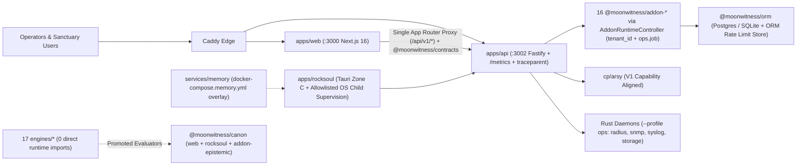

# MoonWitness Platform Architecture & Ecosystem Readiness Audit

> **Audit & Remediation Baseline (2026-11-18):** Initially audited read-only on branch `dev` at commit `5c38909019d1034fb671bd64344dc35b16bd29a4`, then hardened across P0–P2 on `dev` (preserving all pre-existing concurrent workspace edits and keeping `docs/constitution/**` untouched).

## Companion Deliverables

- **Component Inventory JSON:** [PLATFORM-COMPONENT-INVENTORY.json](./PLATFORM-COMPONENT-INVENTORY.json)
- **Application Integration Matrix:** [APPLICATION-INTEGRATION-MATRIX.md](./APPLICATION-INTEGRATION-MATRIX.md)
- **Engine, Package & Addon Integration Matrix:** [ENGINE-PACKAGE-INTEGRATION-MATRIX.md](./ENGINE-PACKAGE-INTEGRATION-MATRIX.md)
- **Hybrid Mini-PaaS Readiness Assessment:** [HYBRID-PAAS-READINESS-ASSESSMENT.md](./HYBRID-PAAS-READINESS-ASSESSMENT.md)
- **Target Architecture Specification:** [PLATFORM-TARGET-ARCHITECTURE.md](./PLATFORM-TARGET-ARCHITECTURE.md)
- **Prioritized Engineering Roadmap (P0–P3):** [PLATFORM-ENGINEERING-ROADMAP.md](./PLATFORM-ENGINEERING-ROADMAP.md)

## 1. Executive Synthesis & Ecosystem Boundary

MoonWitness is one product platform inside the broader `A-L-L-A-H` ecosystem, organized around the three-app Trust Zone topology in [ADR-006](./adr-006-three-app-topology-and-trust-zones.md) and desktop local boundaries in [ADR-007](./adr-007-rocksoul-local-execution-and-data-boundary.md):

1. **Actual Platform Maturity (Post P0–P2 Execution):** **Production-Capable Core Platform with Workspace Tenant Scoping, Durable Queue Foundation & Unified Observability.** Core workspaces pass `32/32` ESLint checks (including `@moonwitness/addon-base`), `32/32` TypeScript typechecks, and `29/29` Vitest tasks totaling `790` tests across `139` files, alongside `go test ./...` (`9` tested `cp/arsy` packages), `33/33` `services/memory/backend` pytests, `27/27` `services/storage` Rust tests, and `56/56` `apps/rocksoul/src-tauri` Rust lib tests. **Readiness Score advanced from `51.4 / 100` to `73.2 / 100`.**
2. **Ecosystem vs Product Separation:** Tier 0 canonical governance stays isolated under [docs/constitution/GOVERNANCE/DOCUMENT-INDEX.md](../constitution/GOVERNANCE/DOCUMENT-INDEX.md), while MoonWitness runtime assets inhabit Zone A (`web`, `api`), Zone B (`cp/arsy` + `4` Rust telemetry/S3 daemons + overlay Python `services/memory`), and Zone C (`apps/rocksoul` Tauri desktop + `17` archived/standalone `engines/*` directories).

## 2. Verified Post-P2 Runtime Architecture (`dev`)

## 3. P0–P2 Implemented Improvements & Remaining P3 Scope

- **P0 Stabilization Completed:** Added [services/storage/Dockerfile](../../services/storage/Dockerfile), aligned `control.routes.ts` to `cp/arsy` V1 supported kinds (`ARSY_V1_SUPPORTED_RESOURCE_KINDS`), consolidated `apps/web` `/api/v1` routing into `apps/web/src/app/api/v1/[...path]/route.ts` while deleting `cloudflare-runtime.ts`, and wired Compose config, `rocksoul-tauri`, and `services/memory` into `.github/workflows/ci.yml`.
- **P1 Consolidation Completed:** Fixed `midFastifyPlugin` `/health` route collision when `MID_KEY_ENCRYPTION_SECRET` is configured, unified `apps/web/src/lib/mid-oidc.ts` onto `@moonwitness/core`, wired `@moonwitness/contracts` into `@moonwitness/web` and `@moonwitness/api` timeline endpoints, consolidated `packages/addons/epistemic` onto `@moonwitness/canon`, retired `commandCenterMigrations` & `probesMigrations` to empty arrays backed by `syncModels()`, added standalone [docker-compose.memory.yml](../../docker-compose.memory.yml), enabled `@moonwitness/addon-base` ESLint, and synced [packages/addons/README.md](../../packages/addons/README.md) to all 16 live addons.
- **P2 Architecture Hardening Completed:** Added `tenant_id` scoping (`DEFAULT_TENANT_ID = "default"`, cross-tenant denial on `BaseRepository` mutations, `/m/:model` + history isolation, `resolveRequestTenant` spoof prevention), `ops.job` durable queue with optimistic locking (`packages/addons/__base/src/job-queue.ts`), pluggable SQL `createOrmRateLimitStore` (`RATE_LIMIT_STORE=orm`), Prometheus `/metrics` & `/api/v1/metrics` + W3C `traceparent` child-span propagation, and allowlisted OS child-process supervision in `apps/rocksoul/src-tauri/src/commands/agent_execution.rs`.
- **Remaining P3 Future Scope:** Dynamic remote/signed addon distribution (beyond static bundling), Postgres RLS policies, full `@moonwitness/contracts` migration across remaining endpoints, external worker daemon/OTLP exporter, and curated promotion of standalone `engines/*` candidates (`witness-semantic`, `ontology`, `moonframe`).

## 4. Summary Verdict & Trajectory

- **Hybrid Mini-PaaS Readiness Score:** **`73.2 / 100`** (`73.23` weighted score across 15 capabilities in [HYBRID-PAAS-READINESS-ASSESSMENT.md](./HYBRID-PAAS-READINESS-ASSESSMENT.md)).
- **Target Shape ([PLATFORM-TARGET-ARCHITECTURE.md](./PLATFORM-TARGET-ARCHITECTURE.md)):** Ready for single-cluster operator and multi-workspace deployment; proceed to **P3** (`engines/*` curation + dynamic signed plugin manifests + Postgres RLS) only under explicit Owner ADRs in [PLATFORM-ENGINEERING-ROADMAP.md](./PLATFORM-ENGINEERING-ROADMAP.md).
