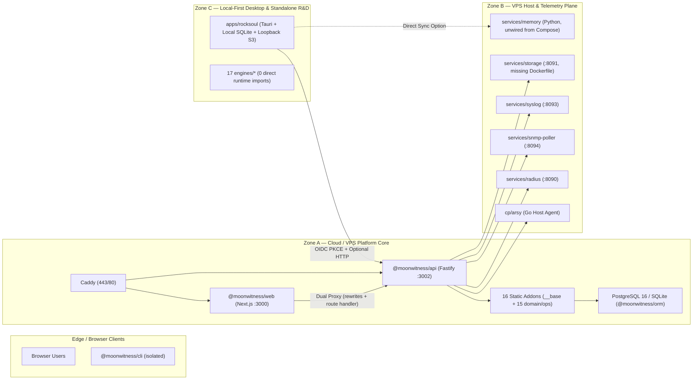
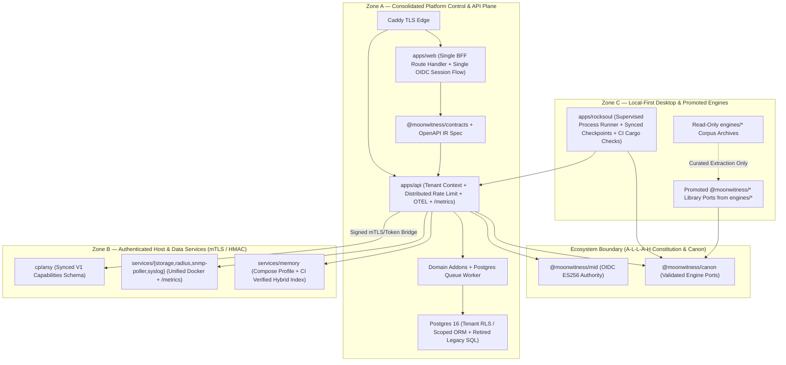

# MoonWitness Hybrid Target Architecture

> Audit baseline: branch `dev`, `HEAD = 5c38909019d1034fb671bd64344dc35b16bd29a4` (`2026-11-18`). Evolves [ADR-006](./adr-006-three-app-topology-and-trust-zones.md) and [ADR-007](./adr-007-rocksoul-local-execution-and-data-boundary.md) without breaching A-L-L-A-H Tier 0 ecosystem boundaries.

## 1. Verified As-Is Platform Architecture (`HEAD = 5c389090`)

## 2. Proposed Hybrid Target Architecture (3 Tiers: Current -> Hybrid Target -> Future Optional)

| Tier                               | Scope                                           | Architectural Shape                                                                                                                                                                                                                                                                                                                                                                                                                        |
| ---------------------------------- | ----------------------------------------------- | ------------------------------------------------------------------------------------------------------------------------------------------------------------------------------------------------------------------------------------------------------------------------------------------------------------------------------------------------------------------------------------------------------------------------------------------ |
| **Verified Current (`dev`)**       | Single-tenant core platform                     | Caddy + Next.js (`web`) + Fastify (`api`, 16 static addons) + Postgres/SQLite + optional Rust telemetry (`--profile ops`) + Go host agent (`cp/arsy`) + local-first `rocksoul`                                                                                                                                                                                                                                                             |
| **Proposed Hybrid Target (P0–P2)** | Hardened single/multi-workspace hybrid platform | Single consolidated BFF proxy on `web` -> `api` via `@moonwitness/contracts`; tenant-scoped `@moonwitness/orm` (`tenant_id` context); `addon-epistemic` consuming `@moonwitness/canon`; `cp/arsy` & API contract symmetry; Postgres-backed async worker/queue inside `api` or wired worker unit; Compose-integrated `services/storage` + `services/memory`; OTEL + Prometheus `/metrics` across `web`, `api`, `cp/arsy`, and Rust services |
| **Future Optional Mini-PaaS (P3)** | Multi-tenant extensible compute & marketplace   | Out-of-process OCI/WASM sandboxed workload scheduling via upgraded control plane; remote signed addon manifests & capability tokens; multi-node Postgres/S3 replication                                                                                                                                                                                                                                                                    |

## 3. Ownership Boundary Split: Platform Core vs Domain/R&D Engines vs Desktop

| Concern                                                         | Owning Layer                                                                                                      | Target Rule                                                                                                                           |
| --------------------------------------------------------------- | ----------------------------------------------------------------------------------------------------------------- | ------------------------------------------------------------------------------------------------------------------------------------- |
| Identity, RBAC, Tenant Context, Audit, Rate Limiting, Telemetry | **Platform Core (`@moonwitness/mid`, `@moonwitness/orm`, `addon-auth`, `addon-audit`, `addon-base`, `apps/api`)** | Every DB query & mutation carries `ActorContext` + `tenantId` (`DEFAULT_TENANT` only in single-tenant compatibility mode)             |
| Edge Proxy, CSRF Cookie Handling, Dynamic Studio/UI Chrome      | **Web BFF & UI (`apps/web`, `@moonwitness/ui`, `@moonwitness/contracts`)**                                        | Single BFF handler (`src/app/api/v1/[...path]/route.ts`); retire duplicate rewrite & extra PKCE clients                               |
| VPS Systemd/Firewall/VPN/DNS Reconciliation                     | **Host Control Plane (`cp/arsy`)**                                                                                | Shared capability manifest constrains `apps/api` `control.routes.ts` so unsupported kinds fail at schema validation                   |
| Domain Text, Lunar Visibility, RGBL, Semantic Claims            | **Engine Ports (`@moonwitness/canon`) + Addons (`epistemic`, `canon-lore`, `witness-research`)**                  | No duplicated domain math inside addon folders; `engines/*` remains upstream R&D/corpus archive until promoted via versioned packages |
| Offline Editing, Supervised Local Commands, Drive/S3 Backup     | **Local Desktop (`apps/rocksoul` / Trust Zone C)**                                                                | Never holds multi-tenant platform secrets; synchronizes via explicit user-scoped OIDC PKCE tokens                                     |
