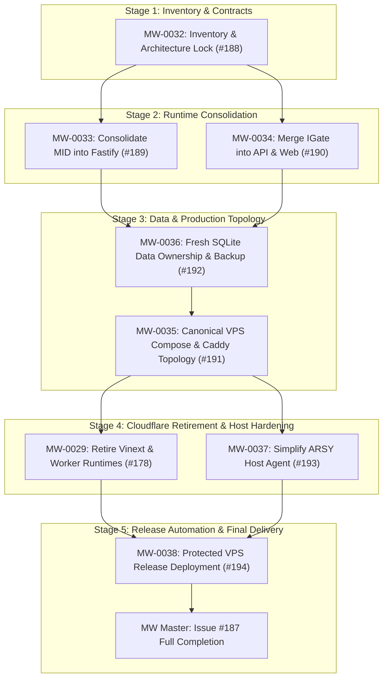

# MoonWitness Runtime, Service Ownership & Cloudflare Dependency Inventory

> [!IMPORTANT]
> **Historical Baseline / Partially Superseded (`EVIDENCE:HISTORICAL`, 2026-11-18; Reconciled 2026-11-19 for `#177` / `#288`):**
> This inventory captures the pre-consolidation `dev` snapshot at commit `1e22fb7` (2026-11-17) and is preserved verbatim in §1–§4 for audit provenance. Several assumptions in §1–§4 have since been **superseded** by [ADR-006](./adr-006-three-app-topology-and-trust-zones.md), [ADR-007](./adr-007-rocksoul-local-execution-and-data-boundary.md), [POSTGRES-STANDARDIZATION-PLAN.md](./POSTGRES-STANDARDIZATION-PLAN.md) (`#288`), and the active [docker-compose.yml](../../docker-compose.yml) / [Caddyfile](../../Caddyfile): (1) `apps/a-l-l-a-h` was consolidated into unified `apps/web`; (2) `apps/memory` moved to Zone C `services/memory`; (3) production Compose `apps/api` runs on PostgreSQL (`postgres:16-alpine` / `PostgresDriver`), while PostgreSQL-only standardization across `services/*` (Wave B) and Zone C (Wave C) is tracked in [POSTGRES-STANDARDIZATION-PLAN.md](./POSTGRES-STANDARDIZATION-PLAN.md); and (4) `services/storage` plus optional `ops` services run under `--profile ops` with explicit `MW_OPS_*` readiness and `503 SERVICE_DISABLED` gates on `/api/v1/readyz`. See the [Current Reconciliation Addendum](#current-reconciliation-addendum-dev--186263f-177--288) below.

**Status:** Canonical Architecture Inventory (MW-0032 / Master Issue #187)  
**Baseline Date:** 2026-11-17  
**Branch:** `dev` (Commit `1e22fb7`)  
**Target Topology:** Single-VPS Docker Compose V2 + Caddy Reverse Proxy, Node.js Frontends & Core API, Dedicated Specialized Services

---

## 1. Executive Summary & Non-Negotiable Boundaries

This inventory establishes the verified source, runtime, data ownership, and Cloudflare dependency map across the `A-L-L-A-H/moonwitness` monorepo prior to executing consolidation tasks (#189, #190, #178, #191, #192, #193, #194).

### Core Boundaries (from Master Plan #187)

1. **Two Independent Frontend Products:**
   - `apps/a-l-l-a-h` (Empire of Light / Sovereign Sanctuary): Next.js 15, hostname `a-l-l-a-h.com`.
   - `apps/web` (MoonWitness Dock, Mission Control, Operations): Next.js 15, hostname `moonwitness.biz.id`.
   - _These frontends must not be merged or combined into a single application._
2. **One Core Application Runtime:**
   - `apps/api` (Fastify 5) is the single server runtime for core domain logic, operational proxies, and identity.
   - `apps/mid` (canonical OIDC authority) is consolidated into the Fastify process as a dedicated module boundary maintaining the issuer `https://id.moonwitness.biz.id`.
   - `apps/igate` NOC health-probe capabilities are merged into the Core API and Mission Control; the standalone Worker and D1 database are retired.
3. **Dedicated Specialized Services (Kept for Distinct Lifecycles/Protocols):**
   - `services/radius`: Rust RADIUS authentication (RFC 2865) and accounting (RFC 2866) service for MikroTik/NAS clients.
   - `services/snmp-poller`: Rust SNMP polling service (v1/v2c, v3 target).
   - `services/syslog`: Rust bounded syslog ingestion (RFC 3164/5424) service.
   - `services/storage`: Rust S3-compatible object storage service with SigV4 signing, backing the MoonWitness Operations Storage Explorer.
4. **Single VPS Production Topology:**
   - One VPS host running Docker Engine + Docker Compose V2.
   - Caddy is the single reverse proxy publishing public ports 80 and 443.
   - All internal APIs and database handles remain on private Docker networks.
   - MikroTik RouterOS acts as a network client/NAS communicating via RADIUS; no database is deployed on MikroTik.
5. **Fresh SQLite Database Initialization:**
   - Owner confirmation: current Cloudflare D1 databases are empty. Zero legacy D1 export/import, dual-write, or data migration is planned or performed.
   - Every stateful service owns exactly one SQLite/libSQL database file on persistent volume storage.

---

## 2. Workspace & Runtime Inventory

### 2.1 Applications (`apps/*`)

| Workspace        | Product / Role                                   | Language / Runtime                               | Entrypoint                     | Listening Ports             | Public Hostname                    | DB / Persistence                       | Target Decision                                         |
| ---------------- | ------------------------------------------------ | ------------------------------------------------ | ------------------------------ | --------------------------- | ---------------------------------- | -------------------------------------- | ------------------------------------------------------- |
| `apps/a-l-l-a-h` | Sovereign Sanctuary & Canon Codex                | TypeScript / Node.js 20+ (Next.js 15 App Router) | `next start` (container)       | `3003` (private)            | `a-l-l-a-h.com`                    | None (reads Core API & Canon package)  | **KEEP** (Retire Vinext/Cloudflare Worker)              |
| `apps/web`       | MoonWitness Dock & Mission Control               | TypeScript / Node.js 20+ (Next.js 15 App Router) | `next start` (container)       | `3000` (private)            | `moonwitness.biz.id`               | Browser localStorage / Session cookies | **KEEP** (Retire Vinext/Cloudflare Worker)              |
| `apps/api`       | Core Application Fastify API & BFF               | TypeScript / Node.js 20+ (Fastify 5)             | `dist/index.js` (container)    | `3002` (private)            | `api.moonwitness.biz.id` (proxied) | `data/moonwitness.db` (SQLite/libSQL)  | **KEEP & EXPAND** (Hosts MID & IGate logic)             |
| `apps/mid`       | Canonical OIDC Identity Authority                | TypeScript / Cloudflare Worker (D1)              | `src/index.ts`                 | Edge fetch handler          | `id.moonwitness.biz.id`            | D1 `rocksoul-auth-db` (empty)          | **MERGE** into `apps/api` Fastify runtime               |
| `apps/igate`     | Sovereign NOC Probe Worker & Console             | TypeScript / Cloudflare Worker (D1)              | `src/index.ts`                 | Edge fetch handler          | `igate.moonwitness.biz.id`         | D1 `igate-worker-db` (empty)           | **MERGE** into `apps/api` & `apps/web` Mission Control  |
| `apps/cli`       | Sovereign OIDC Loopback CLI (`@moonwitness/cli`) | TypeScript / Node.js 20+ CLI                     | `dist/cli.js`                  | Dynamic loopback (RFC 8252) | Local client                       | Local config file                      | **KEEP** (Independent developer tool)                   |
| `apps/memory`    | Multi-Agent Neural Memory Assistant              | Python (FastAPI) + Next.js                       | `uvicorn backend.app.main:app` | `8000` / `3005` (local)     | Local desktop / dev                | Local SQLite / Chroma vector DB        | **KEEP** (Local-first desktop only; not in VPS Compose) |
| `apps/rocksoul`  | Sovereign Operator Studio (Tauri v2)             | Rust + React / Vite                              | `src-tauri` native binary      | Desktop client              | Local native desktop               | Local client state                     | **KEEP** (Desktop application only; not in VPS Compose) |

### 2.2 Specialized Backend Services (`services/*`)

| Service | Protocol / Purpose | Language / Runtime | Entrypoint | Listening Ports | Persistence | Callers | Target Decision |
|---|---|---|---|---|---|---|
| `services/radius` | RADIUS RFC 2865 (Auth) & RFC 2866 (Acct) | Rust 1.85+ (Tokio) | `target/release/radius` | UDP `1812` (Auth), UDP `1813` (Acct), HTTP `8092` (Health/Metrics) | `data/radius.db` (SQLite) | MikroTik RouterOS NAS peers, Core API | **KEEP** (Dedicated Compose container) |
| `services/snmp-poller` | Network Telemetry Polling (SNMP v1/v2c) | Rust 1.85+ (Tokio) | `target/release/snmp-poller` | HTTP `8094` (Control/Metrics) | `data/snmp.db` (SQLite) | Core API `/api/v1/snmp` proxy, Network switches/routers | **KEEP** (Dedicated Compose container) |
| `services/syslog` | High-Throughput Syslog Ingestion (RFC 3164/5424) | Rust 1.85+ (Tokio) | `target/release/syslog` | UDP `5140`, TCP `5514`, HTTP `8093` (Metrics/Health) | `data/syslog.db` (SQLite, bounded batch prune) | Network devices, Linux hosts, Core API `/api/v1/syslog` proxy | **KEEP** (Dedicated Compose container) |
| `services/storage` | S3-Compatible Object Store with SigV4 Signing | Rust 1.85+ (Axum/Tokio) | `target/release/storage` | HTTP `8091` (S3 API, Health) | `data/storage.db` (Metadata) + `data/objects/` (Blob store) | Core API `/api/v1/storage` proxy, `apps/web` Storage Explorer | **KEEP** (Dedicated Compose container) |

### 2.3 Host Management Control Plane (`cp/*`)

| Component | Purpose                                            | Language / Runtime | Entrypoint  | Listening Ports                  | Host Privilege                                        | Target Decision                                                                                        |
| --------- | -------------------------------------------------- | ------------------ | ----------- | -------------------------------- | ----------------------------------------------------- | ------------------------------------------------------------------------------------------------------ |
| `cp/arsy` | Host telemetry, Docker inventory, container health | Go 1.24+           | `cmd/arsyd` | `127.0.0.1:8090` (loopback only) | Bounded systemd unit; accesses `/var/run/docker.sock` | **SIMPLIFY** (Keep host metrics, Compose inventory, container lifecycle; remove arbitrary shell & K8s) |

### 2.4 Engines & Shared Packages

| Workspace                  | Purpose                                                | Nature                           | Target Decision                      |
| -------------------------- | ------------------------------------------------------ | -------------------------------- | ------------------------------------ |
| `packages/core`            | OIDC PKCE/ES256 verification, env parsing, crypto      | Shared TypeScript library        | **KEEP**                             |
| `packages/ui`              | Sovereign UI components, shadcn/radix primitives       | Shared React component library   | **KEEP**                             |
| `packages/contracts`       | Domain models, event schemas, API contracts            | Shared TypeScript definitions    | **KEEP**                             |
| `packages/orm`             | Schema-driven repository, soft delete, audit log       | Shared TypeScript DB utility     | **KEEP** (Support libSQL/SQLite)     |
| `packages/canon`           | Sovereign 4-Door Canon, epistemic & narrative registry | Static TypeScript canon registry | **KEEP**                             |
| `packages/types`           | Ambient monorepo types                                 | Shared type declarations         | **KEEP**                             |
| `packages/assets`          | Design system assets, iconography, manifestos          | Static media assets              | **KEEP**                             |
| `packages/avatars`         | Identity avatar presets & SVG definitions              | Static assets                    | **KEEP**                             |
| `engines/rocksoul-ui`      | Specialized Rocksoul visual primitives                 | Shared UI components             | **KEEP**                             |
| `engines/rocksoul-domains` | Domain registration schemas & web wrangler asset       | Static metadata / definitions    | **REVIEW / ARCHIVE** unused assets   |
| `engines/crayon`           | Crayon AI documentation & schema definitions           | Research / AI engine schemas     | **KEEP** (Isolated from VPS runtime) |
| `engines/corpus-srgbl`     | Corpus research & language models                      | Research data                    | **KEEP** (Isolated from VPS runtime) |
| `engines/dhgs` / `aqel`    | Historical sovereign engines                           | Research data                    | **KEEP** (Isolated from VPS runtime) |

---

## 3. Cloudflare Dependencies & Edge Inventory

The monorepo contains both source configurations and catalog references. The table below classifies their current state into:

- **CONFIGURED:** Present in repository configuration files (`wrangler.jsonc`, `cloudflare.config.ts`).
- **DEPLOYED:** Verified deployed to Cloudflare Edge during audit.
- **PRODUCTION-VERIFIED:** Actively handling production domain traffic.

| Name                    | Type / Route           | Zone / Hostname                         | Bindings                                                           | State                            | Target Action                                                                                               |
| ----------------------- | ---------------------- | --------------------------------------- | ------------------------------------------------------------------ | -------------------------------- | ----------------------------------------------------------------------------------------------------------- |
| `moonwitness-web`       | Worker (Vinext)        | `moonwitness.biz.id/*`                  | `ASSETS`, `API_SERVICE`, `API_INTERNAL_URL`                        | DEPLOYED (`3702355a`)            | **RETIRE Worker**: Replace with Node Next.js container behind Caddy.                                        |
| `allah-sanctuary`       | Worker (Vinext)        | `a-l-l-a-h.com/*`                       | `ASSETS`, `DB` (`sovereign-codex-db`), `CORPUS_BUCKET`, `CACHE_KV` | DEPLOYED (`93e47a38`)            | **RETIRE Worker**: Replace with Node Next.js container behind Caddy.                                        |
| `moonwitness-api`       | Worker (Fastify fetch) | `api.moonwitness.biz.id/*`              | `DB` (`rocksoul-auth-db`)                                          | DEPLOYED                         | **RETIRE Worker**: Fastify runs as canonical Node.js container on VPS.                                      |
| `moonwitness-id`        | Worker (MID OIDC)      | `id.moonwitness.biz.id` (custom domain) | `DB` (`rocksoul-auth-db`)                                          | DEPLOYED (`c2dac784`)            | **RETIRE Worker**: Port MID request handlers into Fastify. Caddy routes `id.moonwitness.biz.id` to Fastify. |
| `rocksoul-igate-worker` | Worker (NOC Probe)     | `igate.moonwitness.biz.id/*`            | `DB` (`igate-worker-db`)                                           | DEPLOYED (`7f7401b2`)            | **RETIRE Worker & D1**: Move probe logic to Fastify and Mission Control.                                    |
| `rocksoul-web`          | Worker Assets          | None configured                         | Static assets                                                      | CONFIGURED                       | **DEFER / RETAIN** for static docs only.                                                                    |
| `sovereign-codex-edge`  | Catalog Edge           | `codex.a-l-l-a-h.com`                   | Edge Worker                                                        | CATALOG ONLY (Not in repo build) | **PRESERVE** health probe target; no repo changes.                                                          |
| `rocksoul-community`    | Catalog Edge           | `community.moonwitness.biz.id`          | Edge Worker                                                        | CATALOG ONLY (Not in repo build) | **PRESERVE** health probe target; no repo changes.                                                          |
| `moonwitness-radio`     | Catalog Edge           | `moonwitness-radio.bjo163.workers.dev`  | Edge Worker                                                        | CATALOG ONLY (Not in repo build) | **PRESERVE** health probe target; no repo changes.                                                          |

### D1 Database Inventory (Confirmed Empty by Owner)

- `rocksoul-auth-db` (`6fc89089-5dda-420e-bae1-019d8c6b2d65`): Associated with `moonwitness-api` and `moonwitness-id`.
- `igate-worker-db` (`1267ccd2-77ad-4353-8991-5dfe0c157cd0`): Associated with `rocksoul-igate-worker`.
- `sovereign-codex-db` (`3dc374d8-ae42-4086-9879-eb1730c89f11`): Associated with `allah-sanctuary`.
  _No export, synchronization, or dual-write is performed. Fresh local schemas are initialized._

---

## 4. Component Decision Matrix

| Component                        | Target Action             | Primary Justification                                                  | Dependencies                                            |
| -------------------------------- | ------------------------- | ---------------------------------------------------------------------- | ------------------------------------------------------- |
| `apps/a-l-l-a-h`                 | **KEEP** (Port to Node)   | Core independent product. Next.js standalone container on VPS.         | Node Next.js build; shared OIDC client with MID.        |
| `apps/web`                       | **KEEP** (Port to Node)   | Core independent product. Next.js standalone container on VPS.         | Node Next.js build; Core API private URL.               |
| `apps/api`                       | **KEEP & CONSOLIDATE**    | Canonical Fastify runtime. Ingests MID OIDC and IGate probes.          | Consolidated libSQL/SQLite database; OIDC routes.       |
| `apps/mid`                       | **MERGE** into `apps/api` | Eliminates standalone Worker/D1; keeps `id.moonwitness.biz.id` domain. | Fastify OIDC module; shared DB handle; PR #195.         |
| `apps/igate`                     | **MERGE** into API & Web  | Consolidates overlapping probe logic; removes separate D1 DB.          | Fastify probe routes; Mission Control UI; PR #190.      |
| `apps/cli`                       | **KEEP**                  | Primary CLI tool for loopback PKCE authentication and diagnosis.       | Canonical MID authority URL.                            |
| `apps/memory`                    | **KEEP (Desktop-only)**   | Local AI memory assistant; excluded from VPS production Compose.       | Local SQLite / FastAPI environment.                     |
| `apps/rocksoul`                  | **KEEP (Desktop-only)**   | Operator studio desktop application; excluded from VPS Compose.        | Tauri v2 desktop build.                                 |
| `services/radius`                | **KEEP**                  | Dedicated protocol lifecycle (UDP RFC 2865/2866).                      | SQLite `data/radius.db`; Docker Compose UDP ports.      |
| `services/snmp-poller`           | **KEEP**                  | Dedicated polling lifecycle.                                           | SQLite `data/snmp.db`; private network.                 |
| `services/syslog`                | **KEEP**                  | High-throughput bounded ingest (UDP 5140/TCP 5514).                    | SQLite `data/syslog.db`; private network.               |
| `services/storage`               | **KEEP**                  | S3-compatible SigV4 blob storage backing Web Storage Explorer.         | SQLite `data/storage.db` + persistent volume directory. |
| `cp/arsy`                        | **SIMPLIFY**              | Host management bounded to inventory, metrics, restart.                | Restricted systemd service; Docker socket read.         |
| Vinext / Cloudflare App Runtimes | **REMOVE**                | Eliminates dual-runtime complexity in favor of Node.js.                | Node.js production verification (#178).                 |

---

## 5. Persistent Data Ownership & Schema Layout

| Owning Service          | SQLite Database File                                                          | Tables / Schema Responsibilities                                                                                                                                         | Backup / Recovery Policy                                                                       |
| ----------------------- | ----------------------------------------------------------------------------- | ------------------------------------------------------------------------------------------------------------------------------------------------------------------------ | ---------------------------------------------------------------------------------------------- |
| `apps/api` (Core + MID) | `/var/lib/moonwitness/data/moonwitness.db`                                    | Users, sessions, roles, audit logs, MID signing keys (`oidc_keys`), registered clients (`oidc_clients`), auth codes, refresh tokens, probe targets, probe event history. | WAL mode. Nightly encrypted SQLite `.backup` to off-host storage. Tested restore verification. |
| `services/radius`       | `/var/lib/moonwitness/data/radius.db`                                         | NAS peers, RADIUS users, radcheck, radreply, radacct (accounting session history).                                                                                       | WAL mode. Nightly backup.                                                                      |
| `services/snmp-poller`  | `/var/lib/moonwitness/data/snmp.db`                                           | SNMP devices, polling profiles, metrics time-series snapshots.                                                                                                           | WAL mode. Retained for 30 days.                                                                |
| `services/syslog`       | `/var/lib/moonwitness/data/syslog.db`                                         | Ingested syslog messages (RFC 3164/5424), bounded rowid retention pruning.                                                                                               | WAL mode. Bounded table pruning (max rows configured).                                         |
| `services/storage`      | `/var/lib/moonwitness/data/storage.db` & `/var/lib/moonwitness/data/objects/` | S3 bucket metadata, object metadata, binary object chunks on persistent disk.                                                                                            | WAL mode. Metadata backup + file tree snapshot.                                                |
| MikroTik RouterOS       | _None_                                                                        | Network device / client only. No application data or database.                                                                                                           | RouterOS configuration export via ARSY/Operator runbook.                                       |

---

## 6. Dependency & Cutover Sequence

### Critical Serial Constraints:

1. **MID Fastify Integration (MW-0033)** must precede **Worker Retirement (MW-0029)** so frontends always have a valid OIDC issuer.
2. **SQLite Schema Definition (MW-0036)** must precede **Docker Compose Topology (MW-0035)** to bind volume mount points correctly.
3. **Canonical Caddy Configuration (MW-0035)** must precede live DNS cutover to ensure zero downtime.

---

## 7. Assumptions Requiring Live Verification

The following items are source/configuration findings and must be verified against live infrastructure at cutover time:

1. **Live DNS & Edge Routing:** Confirm that Cloudflare DNS proxy mode (orange cloud) or direct DNS (gray cloud) can point `moonwitness.biz.id`, `a-l-l-a-h.com`, `id.moonwitness.biz.id`, and `api.moonwitness.biz.id` directly to the VPS public IP (`apps.mycocolink.com`).
2. **Host Firewall & Port Ingress:** Verify that UFW/nftables on the VPS permits incoming TCP 80/443 (Caddy) and UDP 1812/1813 (RADIUS from allowed MikroTik subnet), while blocking public access to internal ports (3000, 3002, 3003, 8090, 8091, 8092, 8093, 8094).
3. **Docker Engine & Storage Drivers:** Verify that Docker Engine on `apps.mycocolink.com` supports Compose V2 and persistent volume mounts at `/var/lib/moonwitness/data`.
4. **Self-Hosted Runner Isolation:** Ensure that untrusted PR runners run in ephemeral sandboxes without host Docker socket mounts or production credentials (MW-0017 / #165).

---

## Wave 0 Verified Workspace & Upstream Inventory (`dev` @ `acdc72a`)

> Audited for `MW-0003` & `MW-0004`. Governs alongside [ADR-006](adr-006-three-app-topology-and-trust-zones.md).

### Verified Workspace Inventory (`apps`, `packages`, `services`, `cp`)

- **`apps/` (7 current -> 3 target per ADR-006):**
  - `@moonwitness/api` (`apps/api`) — **Retain.** Depends on `@moonwitness/addon-base`, `@moonwitness/addon-timeline`, `@moonwitness/ai`, `@moonwitness/core`, `@moonwitness/errors`, `@moonwitness/mid`, `@moonwitness/orm`, `@moonwitness/schema`, `@moonwitness/types`.
  - `@moonwitness/web` (`apps/web`) — **Retain.** Depends on `@moonwitness/assets`, `@moonwitness/avatars`, `@moonwitness/canon`, `@moonwitness/core`, `@moonwitness/types`, `@moonwitness/ui`.
  - `rocksoul-dx` (`apps/rocksoul` + `apps/rocksoul/src-tauri`) — **Retain.** Depends on `@moonwitness/canon`, `@moonwitness/core`, `@moonwitness/ui`.
  - `@moonwitness/cli` (`apps/cli`) — **Move to `packages/cli` (`MW-0103`).** Depends on `@moonwitness/core`.
  - `@moonwitness/igate` (`apps/igate`) — **Retire (`MW-0105`).** Depends on `@moonwitness/core`.
  - `@moonwitness/mid` (`apps/mid`) — **Consolidate into API-owned identity (`MW-0108`).** Consumed internally by `@moonwitness/api`.
  - `apps/memory` (`moonwitness-memory-web` + `apps/memory/backend`) — **Relocate to private `services/memory` (`MW-0110`–`MW-0112`).**
- **`packages/` (12 shared + 5 addon directories):**
  - Shared: `@moonwitness/ai`, `@moonwitness/assets`, `@moonwitness/avatars`, `@moonwitness/canon`, `@moonwitness/contracts`, `@moonwitness/core`, `@moonwitness/errors`, `@moonwitness/eslint-config`, `@moonwitness/orm`, `@moonwitness/schema`, `@moonwitness/types`, `@moonwitness/typescript-config`, `@moonwitness/ui`.
  - Addons (`packages/addons/*`): `@moonwitness/addon-base` (`__base`), `@moonwitness/addon-timeline` (`timeline`), plus non-package directories `ai`, `auth`, `i18n`.
- **`services/` (4 Rust Cargo crates):** `radius`, `snmp-poller`, `storage`, `syslog`.
- **`cp/`:** `cp/arsy` (Go control plane, `cp/arsy/go.mod`).

### Verified API Upstream URLs & Open Runtime Gaps (`MW-0004`)

| Env / Upstream    | Code Default (`apps/api/src/shared/env.ts`) | `docker-compose.yml` Value | Status & Wave Target                                                                                                                             |
| ----------------- | ------------------------------------------- | -------------------------- | ------------------------------------------------------------------------------------------------------------------------------------------------ |
| `RADIUS_URL`      | `http://127.0.0.1:8090`                     | `http://radius:8090`       | Active in Compose; UDP bind defaults `${RADIUS_BIND_IP:-0.0.0.0}:1812/1813` (tighten in `MW-0504`)                                               |
| `SNMP_POLLER_URL` | `http://127.0.0.1:8094`                     | `http://snmp-poller:8094`  | Active in Compose; move to optional `ops` profile in `MW-0502`                                                                                   |
| `SYSLOG_URL`      | `http://127.0.0.1:8093`                     | `http://syslog:8093`       | Active in Compose; move to optional `ops` profile in `MW-0502`                                                                                   |
| `STORAGE_URL`     | `http://127.0.0.1:8091`                     | _Not configured_           | **MISMATCH (`MW-0501`):** Compose lacks `storage` service and `STORAGE_URL` override; container requests currently hit loopback `127.0.0.1:8091` |
| `DATABASE_URL`    | PostgreSQL expected in prod                 | PostgreSQL service present | **MISMATCH (`MW-0505`):** `Dockerfile` `api` stage sets `ENV DATABASE_URL=/data/moonwitness.db`                                                  |

### IGate Parity & Retirement Matrix (`MW-0104` / `MW-0105`)

| Legacy `apps/igate` Endpoint                   | Replacement in `apps/api`                                           | Parity Status                                                   |
| ---------------------------------------------- | ------------------------------------------------------------------- | --------------------------------------------------------------- |
| `GET /health`, `/health/live`, `/health/ready` | `GET /health`, `/health/live`, `/health/ready`                      | Covered by `health.routes.ts`                                   |
| `GET /api/status`                              | `GET /api/v1/igate/status` & `GET /api/v1/probes/nodes` + `/events` | Covered by `probes.routes.ts` (`requireAuth`)                   |
| `POST /api/probe`                              | `POST /api/v1/igate/probe` & `POST /api/v1/probes/run`              | Covered by `probes.routes.ts` (`requireRole("admin","editor")`) |
| Standalone Cloudflare D1 + UI HTML             | Retired (`apps/web` hosts authenticated console)                    | Standalone worker decommissioned across PR W1-B & W1-C          |

---

## Current Reconciliation Addendum (`dev` @ `186263f`, `#177` / `#288`)

> Preserves historical §1–§4 tables above (`EVIDENCE:HISTORICAL`) while recording verified current runtime topology, optional `ops` gating, and persistence status against [POSTGRES-STANDARDIZATION-PLAN.md](./POSTGRES-STANDARDIZATION-PLAN.md) (`#288` / `MW-0805`).

### Optional `ops` Feature Gates & Readiness (`#284`)

- `apps/api` evaluates optional `ops` profile services (`radius`, `snmp`, `syslog`, `storage`) via `isOptionalOpsServiceEnabled` and `getDisabledOptionalOpsErrorPayload` in `packages/addon-runtime/src/upstream.ts`, honoring `MW_OPS_ENABLED`, per-service `MW_OPS_<SERVICE>_ENABLED` (`MW_OPS_RADIUS_ENABLED`, `MW_OPS_SNMP_ENABLED`, `MW_OPS_SYSLOG_ENABLED`, `MW_OPS_STORAGE_ENABLED`), and legacy `MW_ADDON_<SERVICE>_DISABLED`.
- Disabled optional `ops` capabilities fail closed with deterministic HTTP `503` (`{ error: "SERVICE_DISABLED", service, enabled: false }`) on addon/upstream proxies instead of probing unreachable upstreams.
- Readiness probes on `GET /api/v1/readyz` (and `/readyz`, `/health/ready` in `apps/api/src/interface/routes/health.routes.ts`) verify database connectivity and call `probeOptionalOpsServices({ timeoutMs: 250 })`, reporting disabled services explicitly as `{ enabled: false, status: "disabled" }`.

### Verified Current Persistence Status (Cross-Ref: [POSTGRES-STANDARDIZATION-PLAN.md](./POSTGRES-STANDARDIZATION-PLAN.md))

| Surface                                                     | Verified Current Persistence State                                                                                                                                               | Standardization Target & Status                                                                                                   |
| ----------------------------------------------------------- | -------------------------------------------------------------------------------------------------------------------------------------------------------------------------------- | --------------------------------------------------------------------------------------------------------------------------------- |
| Core API (`apps/api` + `packages/mid`)                      | PostgreSQL (`postgres:16-alpine`, `PostgresDriver`) enforced in production (`PR #390` + `PR #518`); `LibSqlDriver` retained for isolated unit fixtures                           | **IMPLEMENTED** (Wave A + live PostgreSQL conformance suite `apps/api/src/pg-conformance.test.ts`)                                |
| Edge Host (`apps/edge`, `@moonwitness/edge`)                | `@moonwitness/orm` (`initPostgresDb` via Hyperdrive/`DATABASE_URL` with Cloudflare `initD1Db` fallback) booting centralized `@moonwitness/addons/project` (`26` platform addons) | **IMPLEMENTED** (`apps/edge/src/runtime.ts`, `@moonwitness/ui` static SPA + Cloudflare Worker)                                    |
| `services/*` (`radius`, `snmp-poller`, `syslog`, `storage`) | `sqlx` `postgres`/`any` + `init_postgres_pool` (`sqlx::migrate!`) wired to dedicated Compose `--profile ops` DBs (`radius`, `snmp`, `syslog`, `storage`)                         | **IMPLEMENTED** (Wave B `PR #519` + `docker-compose.yml` per-service PG URLs)                                                     |
| Zone C (`apps/rocksoul`, `services/memory`)                 | Loopback-only PG guard (`validate_private_postgres_url`), `pgvector` HNSW DDL (`POSTGRES_SCHEMA_STATEMENTS`), and non-destructive SQLite reconciliation snapshots                | **IMPLEMENTED** (Wave C private loopback PostgreSQL guards & non-destructive snapshot helpers; original archives stay filesystem) |
