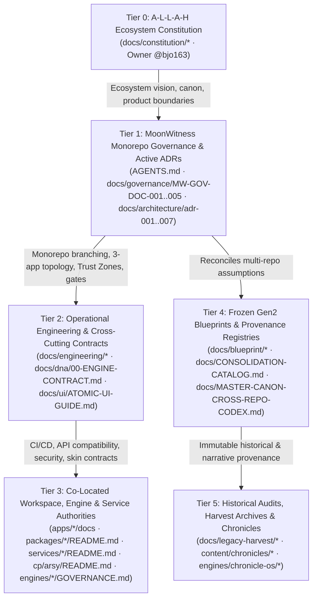

# MoonWitness Documentation Authority Map

## 1. Ecosystem vs. Repository Authority Pyramid

**Tie-Breaking Precedence Rule:** Verified runtime code and passing tests (`pnpm gate:local`, `.github/workflows/ci.yml`) always take precedence over unverified documentation claims when assessing `IMPLEMENTED` status.

---

## 2. Domain-by-Domain Authority & Conflict Map

| Domain                                   | Canonical Authority (SSOT)                                                                                                                                                                                                                     | Verified Code Anchor                                                                                                          | Active Reference Docs                                                                                                                                                                           | Conflicting / Superseded Docs Requiring Reconciliation                                                                                                                                                                                                                                             |
| ---------------------------------------- | ---------------------------------------------------------------------------------------------------------------------------------------------------------------------------------------------------------------------------------------------- | ----------------------------------------------------------------------------------------------------------------------------- | ----------------------------------------------------------------------------------------------------------------------------------------------------------------------------------------------- | -------------------------------------------------------------------------------------------------------------------------------------------------------------------------------------------------------------------------------------------------------------------------------------------------- |
| **Git Branching & Agent Rules**          | [AGENTS.md](../../AGENTS.md), [BRANCHING.md](../engineering/BRANCHING.md)                                                                                                                                                                      | [scripts/branch-guard.mjs](../../scripts/branch-guard.mjs), `.githooks/pre-push`                                              | [GATECHECK.md](../engineering/GATECHECK.md)                                                                                                                                                     | [CONTRIBUTING.md](../../CONTRIBUTING.md) (`git switch -c`); 9 absorbed `engines/*/AGENTS.md` files; [engines/mtime/GOVERNANCE.md](../../engines/mtime/GOVERNANCE.md)                                                                                                                               |
| **Documentation Governance**             | [DOCUMENTATION_GOVERNANCE_CONTRACT.md](./DOCUMENTATION_GOVERNANCE_CONTRACT.md) (`MW-GOV-DOC-001..005`, `ACCEPTED`)                                                                                                                             | N/A (human + Tier 1 gate checks)                                                                                              | [DOCUMENTATION-GOVERNANCE.md](../constitution/GOVERNANCE/DOCUMENTATION-GOVERNANCE.md) (Tier 0), [DOCUMENTATION-CONTRACT.md](../constitution/CONTRACTS/DOCUMENTATION-CONTRACT.md) (Tier 0)       | [allah-com/DOCUMENTATION_CONTRACT.md](../../engines/empire-origin/allah-com/DOCUMENTATION_CONTRACT.md)                                                                                                                                                                                             |
| **Ecosystem Vision & Tawhid Guardrails** | [VISION.md](../constitution/MASTER/VISION.md), [PRODUCT-BOUNDARIES.md](../constitution/MASTER/PRODUCT-BOUNDARIES.md), [VISUAL-CONSTITUTION.md](../constitution/ROCKSOUL-DX/VISUAL-CONSTITUTION.md)                                             | `packages/canon/`                                                                                                             | [MASTER-CANON-CROSS-REPO-CODEX.md](../MASTER-CANON-CROSS-REPO-CODEX.md)                                                                                                                         | None (Tier 0 authoritative)                                                                                                                                                                                                                                                                        |
| **App Topology & Trust Zones**           | [adr-006-three-app-topology-and-trust-zones.md](../architecture/adr-006-three-app-topology-and-trust-zones.md), [adr-007-rocksoul-local-execution-and-data-boundary.md](../architecture/adr-007-rocksoul-local-execution-and-data-boundary.md) | `apps/{api,rocksoul,web}`, `services/memory`, `packages/{cli,mid}`, [scripts/gatecheck.mjs](../../scripts/gatecheck.mjs#L368) | [CONSOLIDATION-CATALOG.md](../CONSOLIDATION-CATALOG.md)                                                                                                                                         | [README.md](../../README.md), [RUNTIME-SERVICE-INVENTORY.md](../architecture/RUNTIME-SERVICE-INVENTORY.md) (§1–4), [docs/blueprint/README.md](../blueprint/README.md), [docs/dna/README.md](../dna/README.md)                                                                                      |
| **VPS & Compose Deployment**             | [docker-compose.yml](../../docker-compose.yml) + [Caddyfile](../../Caddyfile) + [Dockerfile](../../Dockerfile) (pending doc sync)                                                                                                              | `docker-compose.yml`, `Caddyfile`, `.github/workflows/deploy.yml`                                                             | [CI-CD.md](../engineering/CI-CD.md), [RELEASING.md](../engineering/RELEASING.md)                                                                                                                | [VPS-TOPOLOGY-OPERATIONS.md](../architecture/VPS-TOPOLOGY-OPERATIONS.md), [DEPLOYMENT-RUNBOOK.md](../architecture/DEPLOYMENT-RUNBOOK.md), [DEPLOYMENT.md](../engineering/DEPLOYMENT.md), [CI-CD.md](../engineering/CI-CD.md) ("1 workflow"), [RELEASING.md](../engineering/RELEASING.md) (`0.1.0`) |
| **Persistence & DB Ownership**           | `ADR-006` + [packages/orm/src/drivers/postgres.driver.ts](../../packages/orm/src/drivers/postgres.driver.ts) + [docker-compose.yml](../../docker-compose.yml#L78)                                                                              | `packages/orm/`, `apps/api/src/db/`, `services/*/migrations/`                                                                 | [docs/orm-domain-backlog.md](../orm-domain-backlog.md)                                                                                                                                          | [DATA-OWNERSHIP-BACKUP-RESTORE.md](../architecture/DATA-OWNERSHIP-BACKUP-RESTORE.md), [packages/orm/README.md](../../packages/orm/README.md), [RUNBOOK.md](../engineering/RUNBOOK.md), [SECURITY.md](../engineering/SECURITY.md)                                                                   |
| **Identity, OIDC & Audience Policy**     | [MID-AUDIENCE-POLICY.md](../engineering/MID-AUDIENCE-POLICY.md)                                                                                                                                                                                | [packages/mid/src/db.ts](../../packages/mid/src/db.ts), [mid-jwt.ts](../../apps/api/src/middleware/mid-jwt.ts)                | [IDENTITY-SESSION-MODEL-V1.yaml](../blueprint/09-security/IDENTITY-SESSION-MODEL-V1.yaml)                                                                                                       | Legacy references to standalone `apps/mid`                                                                                                                                                                                                                                                         |
| **API Versioning & Contracts**           | [adr-001-api-versioning.md](../architecture/adr-001-api-versioning.md), [API-VERSIONING.md](../engineering/API-VERSIONING.md)                                                                                                                  | `packages/contracts/`, `apps/api/`                                                                                            | [API-STANDARDS.md](../constitution/API/API-STANDARDS.md), [docs/blueprint/06-api/README.md](../blueprint/06-api/README.md)                                                                      | None active (`docs/blueprint/06-api/` is frozen Gen2 design reference)                                                                                                                                                                                                                             |
| **Host Control Plane (`ARSY`)**          | [ARSY-HOST-AGENT-V1.md](../architecture/ARSY-HOST-AGENT-V1.md)                                                                                                                                                                                 | [cp/arsy/cmd/arsy/main.go](../../cp/arsy/cmd/arsy/main.go), [unsupported.go](../../cp/arsy/internal/resources/unsupported.go) | [CONSOLIDATION-CATALOG.md](../CONSOLIDATION-CATALOG.md) §4                                                                                                                                      | [cp/arsy/README.md](../../cp/arsy/README.md), [2026-11-11-arsy-control-plane-design.md](../superpowers/specs/2026-11-11-arsy-control-plane-design.md), [RUNTIME-SERVICE-INVENTORY.md](../architecture/RUNTIME-SERVICE-INVENTORY.md) (`:8090`)                                                      |
| **Local AI Inference (`RIOT AI`)**       | [adr-008-riot-intelligence-baseline.md](../architecture/adr-008-riot-intelligence-baseline.md) + [packages/ai/README.md](../../packages/ai/README.md)                                                                                          | `packages/ai/`, [riot-ai.routes.ts](../../apps/api/src/interface/routes/riot-ai.routes.ts)                                    | [openai-compatible-protocol.md](../../packages/ai/docs/openai-compatible-protocol.md)                                                                                                           | Point-in-time `2026-11-13` claims that RIOT API routes do not yet exist (`riot-ai.routes.ts` now exists on `dev`, subject to `api:test` verification)                                                                                                                                              |
| **Design System, Tokens & Skins**        | [ATOMIC-UI-GUIDE.md](../ui/ATOMIC-UI-GUIDE.md), [00-ENGINE-CONTRACT.md](../dna/00-ENGINE-CONTRACT.md)                                                                                                                                          | [packages/ui/package.json](../../packages/ui/package.json), `packages/ui/src/`                                                | [adr-003-design-tokens.md](../architecture/adr-003-design-tokens.md), [adr-005-visual-regression.md](../architecture/adr-005-visual-regression.md), `docs/dna/01..09`                           | [00-ENGINE-CONTRACT.md](../dna/00-ENGINE-CONTRACT.md) ("do not add Radix"), [ATOMIC-UI-AUDIT.md](../ui/ATOMIC-UI-AUDIT.md) (historical `DEF-01`), [DNA_SKIN_SYSTEM_PLAN.md](../dna/DNA_SKIN_SYSTEM_PLAN.md), [docs/dna/README.md](../dna/README.md)                                                |
| **ROCKSOUL DX Desktop**                  | `ADR-007` + [apps/rocksoul/README.md](../../apps/rocksoul/README.md) + [apps/rocksoul/docs/ARCHITECTURE.md](../../apps/rocksoul/docs/ARCHITECTURE.md)                                                                                          | `apps/rocksoul/src/`, `apps/rocksoul/src-tauri/`                                                                              | [CURRENT-STATE-RECONCILIATION.md](../../apps/rocksoul/docs/reconciliation-v2/CURRENT-STATE-RECONCILIATION.md), [docs/constitution/ROCKSOUL-DX/*](../constitution/ROCKSOUL-DX/PRODUCT-MASTER.md) | Pre-reconciliation `apps/rocksoul/docs/reconciliation-v2/` blueprint target concepts marked deferred                                                                                                                                                                                               |
| **Private Memory Vault (`Zone C`)**      | `ADR-006` + [services/memory/README.md](../../services/memory/README.md) + `services/memory/docs/`                                                                                                                                             | `services/memory/`                                                                                                            | [EVAL-BASELINE.md](../../services/memory/eval/EVAL-BASELINE.md)                                                                                                                                 | Stale standalone-repo wording in `services/memory/README.md`                                                                                                                                                                                                                                       |
| **Canon, Scripture & Provenance**        | [CANON-PROVENANCE-CONTRACT.md](../constitution/CONTRACTS/CANON-PROVENANCE-CONTRACT.md), [docs/constitution/CANON/*](../constitution/CANON/README.md)                                                                                           | `packages/canon/`                                                                                                             | [MASTER-CANON-CROSS-REPO-CODEX.md](../MASTER-CANON-CROSS-REPO-CODEX.md)                                                                                                                         | Unratified research expansions (`RGBL/SRGBL`, `BASS-HUNTER`) preserved distinctly                                                                                                                                                                                                                  |
| **Sovereign R&D Engines (`engines/*`)**  | Co-located `engines/<engine>/{README,GOVERNANCE,spec/*,docs/*}`                                                                                                                                                                                | `engines/*/`                                                                                                                  | [CONSOLIDATION-CATALOG.md](../CONSOLIDATION-CATALOG.md)                                                                                                                                         | Subordinate `engines/*/AGENTS.md` git/CI rules; duplicate `GOVERNANCE.md` in `allah-foundation` vs. `empire-of-the-light`                                                                                                                                                                          |
| **Task & Execution Tracking**            | [WORK_PLAN.md](../../WORK_PLAN.md) (local ledger)                                                                                                                                                                                              | `packages/ui`, `apps/*` tests                                                                                                 | [ECOSYSTEM-ROADMAP.md](../ECOSYSTEM-ROADMAP.md), [LOCAL-AI-EXECUTION-GATE.md](../constitution/GOVERNANCE/LOCAL-AI-EXECUTION-GATE.md)                                                            | `WORK_PLAN.md` UTF-16LE encoding + citation of deleted `MOONWITNESS-GRAND-PLAN-LOCAL-AI.md`                                                                                                                                                                                                        |

---

## 3. Complete Seven-Series ADR Disambiguation Map

| Namespace Prefix        | Location                                                                                                                                                                                                                                                                                                                                            | Sequence Range           | Binding Authority Scope                                                           |
| ----------------------- | --------------------------------------------------------------------------------------------------------------------------------------------------------------------------------------------------------------------------------------------------------------------------------------------------------------------------------------------------- | ------------------------ | --------------------------------------------------------------------------------- |
| `ARCH-ADR-NNN`          | `docs/architecture/adr-NNN-*.md`                                                                                                                                                                                                                                                                                                                    | `adr-001` .. `adr-007`   | **Active Monorepo Architecture** (new ADRs append here from `adr-008`)            |
| `ARCH-DEC-YYYY-MM-DD`   | `docs/architecture/decisions/2026-11-12-riot-intelligence-baseline.md`                                                                                                                                                                                                                                                                              | `2026-11-12`             | **Active Dated Baseline ADR** (RIOT Intelligence)                                 |
| `CONST-ADR-NNNN`        | [ARCHITECTURE-DECISIONS.md](../constitution/GOVERNANCE/ARCHITECTURE-DECISIONS.md)                                                                                                                                                                                                                                                                   | `ADR-0001` .. `ADR-0007` | **Tier 0 Ecosystem Constitution** (`A-L-L-A-H/master-docs` baseline)              |
| `BP-ADR-NNN`            | [DECISION-REGISTRY.md](../blueprint/DECISION-REGISTRY.md) & `docs/blueprint/00-constitution/ADR-021..027`                                                                                                                                                                                                                                           | `ADR-001` .. `ADR-027`   | **Frozen Gen2 Blueprint Reference** (runtime layout reconciled by `ARCH-ADR-006`) |
| `RES-ADR-NNN`           | [research/architecture-decisions.md](../../research/architecture-decisions.md)                                                                                                                                                                                                                                                                      | `ADR-001` .. `ADR-006`   | **Surface Design/Rendering ADRs** (`A-L-L-A-H.COM` Living Light)                  |
| `ENG-<ENGINE>-ADR-NNNN` | `engines/corpus-srgbl/docs/decisions/` (`ADR-0001..0007`), `engines/crayon/rocksoul-crayon/docs/web-ai-integration/decisions/` (`ADR-001..003`), `engines/empire-origin/allah-foundation/docs/adr/` (`ADR-0001..0005`), `engines/empire-origin/empire-of-the-light/docs/adr/` (`ADR-0001..0003`), `engines/rocksoul-domains/aws/docs/` (`ADR-0001`) | Engine-local sequences   | **Engine-Scoped / Historical Upstream Provenance**                                |
| `XV-ADR-NNNN`           | `content/chronicles/moonwitness-xv/docs/decisions/`                                                                                                                                                                                                                                                                                                 | `ADR-0001` .. `ADR-0020` | **Historical Chronicle Provenance**                                               |
