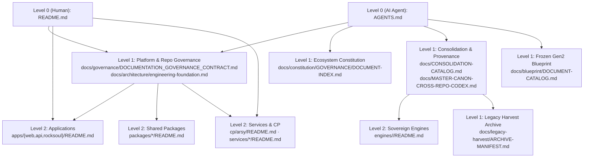

# MoonWitness Documentation Indexing Strategy

## 1. Anti-Sprawl & Non-Competing Index Principles

1. **Mutually Exclusive Scope:** Every index owns a disjoint directory boundary. No two indexes **MAY** compete to define authoritative lists for the same folder.
2. **Two-Hop Discovery Guarantee:** Every active architectural, governance, engineering, application, package, service, or engine entry point **MUST** be reachable in at most **two hops** from [README.md](../../README.md) (for humans) or [AGENTS.md](../../AGENTS.md) (for AI agents).
3. **Never Centralize Engine Indexes:** Root and platform indexes link to `engines/<engine>/README.md` (or umbrella sub-directory `README.md`s), **not** every internal file inside the engine.

---

## 2. Three-Level Federated Index Hierarchy

### Canonical Index Ownership Table

| Level                              | Index File                                                                                                                                              | Exclusive Subtree Owned                                                                                                                                       | Owner                                         | Status                                                                         |
| ---------------------------------- | ------------------------------------------------------------------------------------------------------------------------------------------------------- | ------------------------------------------------------------------------------------------------------------------------------------------------------------- | --------------------------------------------- | ------------------------------------------------------------------------------ |
| **Level 0 (Human)**                | [README.md](../../README.md)                                                                                                                            | Repository topology overview, Compose profiles, quickstart, gates, links to Level 1 hubs & Level 2 apps/services                                              | Repository Architecture                       | `IMPLEMENTED` (Wave 1/4 updated)                                               |
| **Level 0 (AI Agent)**             | [AGENTS.md](../../AGENTS.md)                                                                                                                            | Mandatory AI compliance rules, `dev`-only branch policy, links to `docs/governance/` and Level 1 hubs                                                         | Repository Architecture                       | `ACCEPTED`                                                                     |
| **Level 1 (Platform & Repo)**      | [DOCUMENTATION_GOVERNANCE_CONTRACT.md](./DOCUMENTATION_GOVERNANCE_CONTRACT.md) & [engineering-foundation.md](../architecture/engineering-foundation.md) | `docs/governance/*`, `docs/architecture/*`, `docs/engineering/*`, `docs/dna/*`, `docs/ui/*`, `docs/orm-domain-backlog.md`, `research/*`, `docs/superpowers/*` | Repository Standards & Principal Architecture | `ACCEPTED`                                                                     |
| **Level 1 (Constitution)**         | [DOCUMENT-INDEX.md](../constitution/GOVERNANCE/DOCUMENT-INDEX.md)                                                                                       | `docs/constitution/**` exclusively (`44` files)                                                                                                               | Ecosystem Architecture (`@bjo163`)            | `CANONICAL` (Tier 0)                                                           |
| **Level 1 (Provenance & Engines)** | [CONSOLIDATION-CATALOG.md](../CONSOLIDATION-CATALOG.md) & [MASTER-CANON-CROSS-REPO-CODEX.md](../MASTER-CANON-CROSS-REPO-CODEX.md)                       | Upstream provenance mapping across `engines/*` (`17`), `content/chronicles/*` (`5`), and quarantine rules                                                     | Ecosystem & Repository Architecture           | `CANONICAL`                                                                    |
| **Level 1 (Frozen Blueprint)**     | [DOCUMENT-CATALOG.md](../blueprint/DOCUMENT-CATALOG.md) & [DECISION-REGISTRY.md](../blueprint/DECISION-REGISTRY.md)                                     | `docs/blueprint/**` exclusively (`196` files; frozen reference only)                                                                                          | Frozen Reference Archive                      | `HISTORICAL`                                                                   |
| **Level 1 (Legacy Harvest)**       | [ARCHIVE-MANIFEST.md](../legacy-harvest/ARCHIVE-MANIFEST.md)                                                                                            | `docs/legacy-harvest/**` exclusively (`34` files)                                                                                                             | Historical Archive Custodian                  | `ARCHIVED`                                                                     |
| **Level 2 (Applications)**         | `apps/{web,api,rocksoul}/README.md`                                                                                                                     | Owning app directory & `apps/<app>/docs/**`                                                                                                                   | Application Leads                             | `IMPLEMENTED` (`web`, `api`, `rocksoul`)                                       |
| **Level 2 (Packages)**             | `packages/<pkg>/README.md`                                                                                                                              | Owning package directory (`15` shared packages + `packages/addons` + `addons/timeline`)                                                                       | Package Maintainers                           | `IMPLEMENTED` (16 root/umbrella READMEs)                                       |
| **Level 2 (Services & CP)**        | `cp/arsy/README.md`, `services/<svc>/README.md`                                                                                                         | Owning service/control-plane directory (`cp/arsy`, `radius`, `snmp-poller`, `syslog`, `storage`, `memory`)                                                    | Service / Infra Leads                         | `IMPLEMENTED` (`arsy`, `memory`, `radius`, `snmp-poller`, `storage`, `syslog`) |
| **Level 2 (Engines)**              | `engines/<engine>/README.md` (or umbrella subdir `README.md`)                                                                                           | Internal `engines/<engine>/**` specifications, ADRs, and fixtures                                                                                             | Engine Leads                                  | `IMPLEMENTED` (`moonwitness-os/README.md` added in Wave 3)                     |

For quarantined `VISUAL-*` mirrors (`110` files) and embedded code snapshots inside `docs/`, see [VISUAL-AND-EMBEDDED-ASSETS-DISPOSITION.md](./VISUAL-AND-EMBEDDED-ASSETS-DISPOSITION.md) (`DOC-ADR-008`, `PROPOSED`).

---

## 3. Fast Navigation Routing Table (Developers & AI Agents)

| Task / Question                                                      | Start At                                         | Authoritative Target                                                                                                                                                                                                                           |
| -------------------------------------------------------------------- | ------------------------------------------------ | ---------------------------------------------------------------------------------------------------------------------------------------------------------------------------------------------------------------------------------------------- |
| **What git branch and commit rules apply?**                          | `AGENTS.md`                                      | [AGENTS.md](../../AGENTS.md), [BRANCHING.md](../engineering/BRANCHING.md)                                                                                                                                                                      |
| **What are the active apps and Trust Zones?**                        | `AGENTS.md` -> `MW-GOV-DOC-001`                  | [adr-006-three-app-topology-and-trust-zones.md](../architecture/adr-006-three-app-topology-and-trust-zones.md), [adr-007-rocksoul-local-execution-and-data-boundary.md](../architecture/adr-007-rocksoul-local-execution-and-data-boundary.md) |
| **How are `A-L-L-A-H`, `MoonWitness`, and `ROCKSOUL DX` separated?** | `docs/constitution/GOVERNANCE/DOCUMENT-INDEX.md` | [PRODUCT-BOUNDARIES.md](../constitution/MASTER/PRODUCT-BOUNDARIES.md), [VISION.md](../constitution/MASTER/VISION.md)                                                                                                                           |
| **Where do I find canon, scripture, or character rules?**            | `docs/constitution/GOVERNANCE/DOCUMENT-INDEX.md` | [CANON-PROVENANCE-CONTRACT.md](../constitution/CONTRACTS/CANON-PROVENANCE-CONTRACT.md), [MASTER-CANON-CROSS-REPO-CODEX.md](../MASTER-CANON-CROSS-REPO-CODEX.md)                                                                                |
| **What gates run locally and in CI?**                                | `README.md` -> `engineering-foundation.md`       | [GATECHECK.md](../engineering/GATECHECK.md), [CI-CD.md](../engineering/CI-CD.md)                                                                                                                                                               |
| **How does OIDC / session auth work?**                               | `docs/architecture/engineering-foundation.md`    | [MID-AUDIENCE-POLICY.md](../engineering/MID-AUDIENCE-POLICY.md), [adr-001-api-versioning.md](../architecture/adr-001-api-versioning.md)                                                                                                        |
| **What can `cp/arsy` execute in V1?**                                | `cp/arsy/README.md`                              | [ARSY-HOST-AGENT-V1.md](../architecture/ARSY-HOST-AGENT-V1.md)                                                                                                                                                                                 |
| **How do UI tokens and DNA skins work?**                             | `docs/ui/ATOMIC-UI-GUIDE.md`                     | [ATOMIC-UI-GUIDE.md](../ui/ATOMIC-UI-GUIDE.md), [00-ENGINE-CONTRACT.md](../dna/00-ENGINE-CONTRACT.md)                                                                                                                                          |
| **Where are engine specs (`M-Time`, `SRGBL`, `Crayon`, etc.)?**      | `docs/CONSOLIDATION-CATALOG.md`                  | Owning `engines/<engine>/README.md` & `GOVERNANCE.md`                                                                                                                                                                                          |
| **Is a file historical or active?**                                  | `docs/governance/DOCUMENTATION-AUTHORITY-MAP.md` | [DOCUMENTATION-AUTHORITY-MAP.md](./DOCUMENTATION-AUTHORITY-MAP.md), [DOCUMENTATION_LIFECYCLE_CONTRACT.md](./DOCUMENTATION_LIFECYCLE_CONTRACT.md)                                                                                               |
