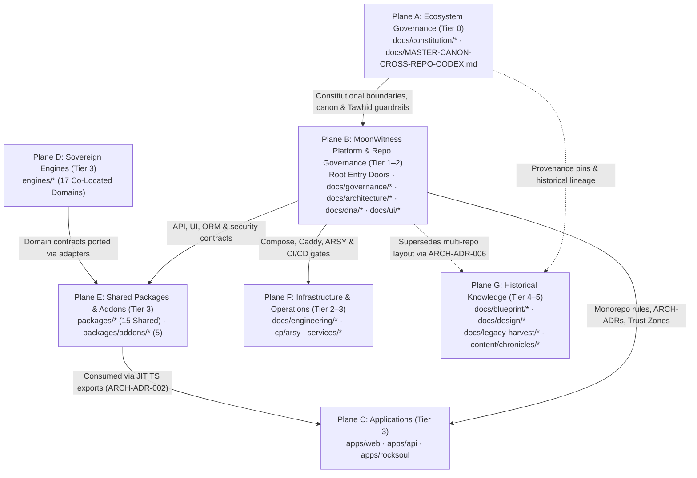

# MoonWitness Target Documentation Architecture

## 1. Phase 1 Validation of Prior Deliverables

Verification against the live `dev` worktree (`3,716` pre-audit Markdown files + `4` audit deliverables prior to this design phase; `113` `docs/` YAML/JSON specifications) confirms the prior deliverables ([DOCUMENTATION_GOVERNANCE_CONTRACT.md](./DOCUMENTATION_GOVERNANCE_CONTRACT.md), [DOCUMENTATION-CONTRACT-REVIEW.md](./DOCUMENTATION-CONTRACT-REVIEW.md), [DOCUMENTATION-AUDIT-REPORT.md](./DOCUMENTATION-AUDIT-REPORT.md), [DOCUMENTATION-INVENTORY.json](./DOCUMENTATION-INVENTORY.json), [DOCUMENTATION-AUTHORITY-MAP.md](./DOCUMENTATION-AUTHORITY-MAP.md), and [DOCUMENTATION-REORGANIZATION-PLAN.md](./DOCUMENTATION-REORGANIZATION-PLAN.md)) accurately reflect repository reality, with three factual refinements captured in this architecture design:

1. **Shared Package README Count:** `packages/` contains **15** shared package directories plus `packages/addons/` (5 subdirectories). Only `packages/orm/README.md` and `packages/addons/timeline/README.md` exist today (`packages/ai` and `packages/assets` hold sub-docs without root READMEs), leaving **14** shared packages and **4** addon directories without root `README.md` files (refined from the earlier audit note of 13).
2. **Umbrella Engine Layout:** Out of 17 `engines/` directories, 12 carry top-level `engines/<engine>/README.md` files while 5 are umbrella groupings (`chronicle-os`, `crayon`, `empire-origin`, `prophetic`, `rocksoul-domains`) whose `README.md` files live inside absorbed sub-directories (with only `engines/chronicle-os/moonwitness-os/` lacking a `README.md`).
3. **Artifact Coverage Extension:** [DOCUMENTATION-MIGRATION-MAP.json](./DOCUMENTATION-MIGRATION-MAP.json) extends coverage across all 884 itemized records, the governance/architecture design artifacts in `docs/governance/`, all 17 bulk engine/chronicle collections, and the missing unit README targets.

---

## 2. Design Principles

1. **Product-in-Ecosystem Distinction:** `A-L-L-A-H` defines overarching constitutional principles, spiritual guardrails, and product separation; `MoonWitness` operationalizes the repository, runtime platform, APIs, and web/desktop workspaces inside `A-L-L-A-H/moonwitness`.
2. **Decentralized Co-Located Ownership:** Documentation lives with the code, schemas, or domain models it governs. Engines, applications, shared packages, services, and control planes never surrender domain docs into a monolithic top-level folder.
3. **One Canonical Authority per Subject:** Cross-cutting standards link upward; never copy normative specifications across files.
4. **Immutable Provenance:** Historical blueprints (`docs/blueprint/`), absorbed master-docs (`docs/constitution/`), audits, and chronicle manuscripts remain intact and clearly demarcated from current runtime architecture (`ARCH-ADR-006`).
5. **Evidence Before Status:** Specification approval (`ACCEPTED`) and implementation verification (`IMPLEMENTED`) remain separate gates backed by source paths, commits, and executed tests.

---

## 3. Seven-Plane Target Documentation Architecture



### Plane A — Ecosystem Governance (`A-L-L-A-H` Overarching Authority, Tier 0)

- **Location:** `docs/constitution/` (`MASTER/`, `CORE/`, `CANON/`, `CONTRACTS/`, `GOVERNANCE/`, `MOONWITNESS/`, `ROCKSOUL-DX/`, `PLATFORM/`, `SECURITY/`, `API/`, `MCP/`, `KNOWLEDGE/`, `TASKS/`) and [MASTER-CANON-CROSS-REPO-CODEX.md](../MASTER-CANON-CROSS-REPO-CODEX.md).
- **Owns:** Ecosystem vision ([VISION.md](../constitution/MASTER/VISION.md)), product separation ([PRODUCT-BOUNDARIES.md](../constitution/MASTER/PRODUCT-BOUNDARIES.md)), Low-Profile Tawhid & Creator–Human boundaries, ROCKSOUL DX Visual Constitution & 4-line manifesto, canon record discipline ([CANON-PROVENANCE-CONTRACT.md](../constitution/CONTRACTS/CANON-PROVENANCE-CONTRACT.md)), and cross-product epistemic rules.
- **Invariant:** No MoonWitness repository document or application feature **MAY** weaken Tier 0 privacy-by-default boundaries or alter owner-ratified canon.

### Plane B — MoonWitness Platform & Repository Governance (Tier 1 & Tier 2)

- **Location:** Root entry doors (`README.md`, `AGENTS.md`, `CONTRIBUTING.md`, `CHANGELOG.md`, `WORK_PLAN.md`), `docs/governance/` (`MW-GOV-DOC-001..005` + architecture/audit/index docs), `docs/architecture/` (`adr-001..007`, `RUNTIME-SERVICE-INVENTORY.md`, `engineering-foundation.md`), `docs/dna/` (`00-ENGINE-CONTRACT.md` .. `09-SIMPUL-NUSANTARA.md`), `docs/ui/` (`ATOMIC-UI-GUIDE.md`), `docs/CONSOLIDATION-CATALOG.md`, `docs/ECOSYSTEM-ROADMAP.md`, and `docs/orm-domain-backlog.md`.
- **Owns:** Repository-wide AI & contributor branching rules (`dev` integration / `main` release), 3-app topology & Trust Zones A/B/C (`ARCH-ADR-006`, `ARCH-ADR-007`), `/api/v1` compatibility (`ARCH-ADR-001`), JIT shared package policy (`ARCH-ADR-002`), DNA skin architecture (`ARCH-ADR-003`), Fastify addon lifecycle (`ARCH-ADR-004`), visual regression policy (`ARCH-ADR-005`), and cross-repo consolidation lineage.

### Plane C — Applications (`apps/{web,api,rocksoul}`, Tier 3)

Each deployable or distributable application strictly owns its local `README.md`, setup/dev commands, route/IPC inventory, app-specific architecture, and local ADRs without bleeding into other apps:

| Workspace        | Trust Zone                               | Target Documentation Structure                                                                                                         | Scope Owned                                                                                                                                                                                           |
| ---------------- | ---------------------------------------- | -------------------------------------------------------------------------------------------------------------------------------------- | ----------------------------------------------------------------------------------------------------------------------------------------------------------------------------------------------------- |
| `apps/web/`      | Zone A (VPS / Public + Operator Console) | `apps/web/README.md` (target) + optional `apps/web/docs/`                                                                              | Next.js 16 App Router routes (unified `A-L-L-A-H` Sanctuary + Nine Worlds + Dock/Mission Control), Pact consumer tests, Playwright configs, `@moonwitness/ui` skin roots                              |
| `apps/api/`      | Zone A (VPS / Private Backend)           | `apps/api/README.md` (target) + optional `apps/api/docs/`                                                                              | Fastify 5 modular monolith, mounted `@moonwitness/mid` OIDC authority, `/api/v1/*` routes, domain persistence migrations, service proxies (`radius`, `snmp-poller`, `syslog`, `storage`), RBAC guards |
| `apps/rocksoul/` | Zone B (Local Owner Workstation)         | Existing [apps/rocksoul/README.md](../../apps/rocksoul/README.md), `apps/rocksoul/docs/*.md`, `apps/rocksoul/docs/reconciliation-v2/*` | Tauri 2 + React 19 + Three.js/R3F Living Universe, `src-tauri` IPC command parity, local SQLite & allowlisted Git controls, local `gate-check.ps1`                                                    |

### Plane D — Sovereign Engines (`engines/*`, Tier 3)

All 17 directories under `engines/` retain their domain specifications, formal models, contracts, fixtures, and `ENG-<ENGINE>-ADR-*` records locally:

- **Single-directory engines (12):** `aqel`, `community`, `corpus-srgbl`, `dhgs`, `divine-text`, `moonframe`, `mtime`, `mw-ui-docs`, `ontology`, `rocksoul-assets`, `rocksoul-ui`, `witness-semantic` — keep top-level `engines/<engine>/README.md`, `GOVERNANCE.md`, `docs/`, and `spec/` co-located.
- **Umbrella/multi-repo engine groups (5):** `chronicle-os`, `crayon`, `empire-origin`, `prophetic`, `rocksoul-domains` — retain absorbed sub-directory `README.md` and `docs/` trees in place as upstream domain provenance, with a clear subordination notice on any absorbed `AGENTS.md` files deferring repo-wide Git/CI rules to root [AGENTS.md](../../AGENTS.md).

### Plane E — Shared Packages & Libraries (`packages/*`, Tier 3)

- **Location:** `packages/<pkg>/README.md` across all 15 shared packages and 5 `packages/addons/*` directories.
- **Owns:** Package purpose, public TypeScript entrypoints (`exports` in `package.json`), `@moonwitness/*` consumer contract, environment/runtime constraints (e.g., server-safe vs. client-only modules in `@moonwitness/ui`, SQLite/libSQL vs. PostgreSQL in `@moonwitness/orm`, OpenAI-compatible protocol boundary in `@moonwitness/ai`), and scoped test commands.

### Plane F — Infrastructure, Services & Operations (Tier 2 & Tier 3)

- **Repository-Wide Operations (Tier 2):**
  - `docs/engineering/` — `BRANCHING.md`, `GATECHECK.md`, `CI-CD.md`, `DEPLOYMENT.md`, `RELEASING.md`, `RUNBOOK.md`, `SECURITY.md`, `API-VERSIONING.md`, `MID-AUDIENCE-POLICY.md`.
  - `docs/architecture/` — `VPS-TOPOLOGY-OPERATIONS.md`, `DEPLOYMENT-RUNBOOK.md`, `DATA-OWNERSHIP-BACKUP-RESTORE.md`, `ARSY-HOST-AGENT-V1.md`, `RELEASE-PROVENANCE.md`, `REPO-SIZE-AUDIT.md`.
- **Service & Control-Plane Docs (Tier 3):**
  - Zone A Data-Plane Workers (`services/{radius,snmp-poller,syslog,storage}/README.md`) — bind ports, SQLite DB file, retention limits, health endpoint, and `apps/api` proxy path.
  - Zone A Host Reconciler ([cp/arsy/README.md](../../cp/arsy/README.md)) — CLI flags, `127.0.0.1:8787` API, V1 7-resource allowlist (`ARSY-HOST-AGENT-V1.md`), `plan`/`apply --confirm` safety invariants.
  - Zone C Private Memory Vault ([services/memory/README.md](../../services/memory/README.md) & `services/memory/docs/*`) — localhost-only FastAPI + FTS5/LanceDB architecture, explicit exclusion from VPS Compose.

### Plane G — Historical Knowledge & Provenance Archives (Tier 4 & Tier 5)

- **Frozen Gen2 Blueprint Reference (Tier 4):** `docs/blueprint/` (`00-constitution` .. `17-genesis`) — design-frozen architectural specification set (`ArsyBelovedLabs/moonwitness-blueprint` @ `7aa4d0e`), non-editable except via explicit freeze governance or archival tagging; multi-repo topology overridden at runtime by `ARCH-ADR-006`.
- **Absorbed Design System & Legacy Harvests (Tier 5):** `docs/design/moonwitness-design-system/`, `docs/legacy-harvest/`, `docs/ui/ATOMIC-UI-AUDIT.md`, `docs/dna/09-UI-ARCHITECTURE-STATUS.md`, `docs/dna/DNA_SKIN_SYSTEM_PLAN.md`, `docs/constitution/GOVERNANCE/DOCUMENT-AUDIT-2026-11-15.md`.
- **Narrative & Chronicle Corpus (Tier 5):** `content/chronicles/` (`1,142` MD files) and `engines/chronicle-os/` (`52` MD files) — preserved read-only for literary/historical lineage.

---

## 4. Documentation Relationships & Traceability Architecture

### End-to-End Traceability Chain

```text
Tier 0 Ecosystem Governance (docs/constitution/)
  └─► Product Requirements (Product Masters · ROCKSOUL-DX · MOONWITNESS)
        └─► Repository Architecture & Trust Zones (docs/architecture/adr-001..007)
              └─► Technical Specifications & Contracts (packages/contracts · docs/dna · engines/*/spec)
                    └─► Implementation Documentation (apps/*/README · packages/*/README · services/*/README)
                          └─► Operational Runbooks & Quality Gates (docs/engineering/* · scripts/gatecheck.mjs)
                                └─► Verified Audit & Release Evidence (Tests · CI Runs · SHA256SUMS · Commit SHAs)
```

### Seven Relationship Rules

1. **Global vs. Scoped Authority:**
   - **Globally authoritative:** Tier 0 (`docs/constitution/`), Tier 1 (`AGENTS.md`, `MW-GOV-DOC-001..005`, `ARCH-ADR-001..007`), and cross-cutting `docs/engineering/*`.
   - **Scoped authoritative:** `apps/<app>/docs/*`, `packages/<pkg>/README.md`, `services/<svc>/README.md`, `cp/arsy/README.md`, and `engines/<engine>/{GOVERNANCE,spec/*,docs/*}` govern exclusively within their workspace boundary and **MUST NOT** alter global Trust Zones, branch policies, or Tier 0 canon.
2. **Upward Referencing Rule:** Local `README.md` and `docs/` files link upward using repository-relative Markdown paths and disambiguated ADR prefixes (e.g., `See [ADR-006](../../docs/architecture/adr-006-three-app-topology-and-trust-zones.md)`), never duplicating global rules inline.
3. **Cross-Engine Dependency Documentation:** When an engine's formal specification (`engines/divine-text`, `engines/mtime`, `engines/crayon`, `engines/corpus-srgbl`, `engines/prophetic`, `engines/dhgs`, `engines/ontology`, `engines/aqel`, `engines/witness-semantic`) is ported into runtime TypeScript, [CONSOLIDATION-CATALOG.md](../CONSOLIDATION-CATALOG.md) records the upstream commit pin and target package (`@moonwitness/canon` or `@moonwitness/ui`), while the target package `README.md` links back to the owning `engines/<engine>/` specification.
4. **Conflict Resolution Protocol:** Conflicts resolve strictly in descending order:
   1. Verified source code + passing tests on `dev` (`EVIDENCE:IMPLEMENTATION`) beats unverified prose when reporting runtime behavior.
   2. Tier 0 Constitution (`docs/constitution/`) governs vision, canon, and privacy boundaries; Tier 1 (`AGENTS.md`, `MW-GOV-DOC-*`, `ARCH-ADR-*`) governs monorepo structure, branching, and workspace topology.
   3. Tier 2/3 scoped docs > Tier 4 Frozen Blueprint (`docs/blueprint/`) > Tier 5 Historical Archives (`docs/legacy-harvest/`, `content/`).
   4. Unreconciled conflicts stay visibly flagged with `NEEDS_REVIEW` or `DISPUTED` until owner ratification.
5. **Implementation Evidence Connection:** No document may claim `IMPLEMENTED` unless its `Implementation Evidence` block cites exact workspace file paths, branch (`dev`), commit SHA, and an executed test/gate command (`pnpm gate:quick`, `pnpm gate:local`, `cargo test`, `go test ./...`) that exited `0`.
6. **Historical Demarcation:** Historical documents carry `ARCHIVED` or `SUPERSEDED` status plus a top-of-file banner identifying the capture date/commit and pointing to the active replacement. Original historical body text and evidence pins are never erased.
7. **ADR Cross-Cutting Binding:** Every breaking topology, persistence, trust-zone, or API change requires an `ACCEPTED` `ARCH-ADR-NNN` before implementation status may transition to `IMPLEMENTED`.
