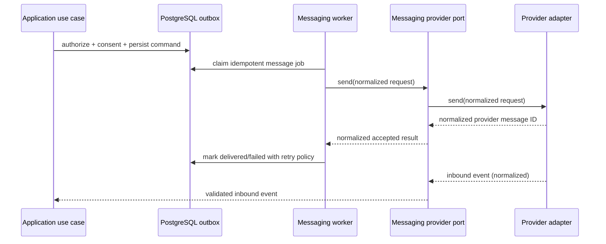

# Messaging Provider Port

The platform messaging boundary is provider-neutral. The central contract version is **1.0.0** and is exported as `MESSAGING_PROVIDER_CONTRACT_VERSION`. Core use cases depend on `createMessagingProviderRegistry` and the versioned contracts in `packages/contracts/src/messaging.js`; they never import Baileys, WhatsApp JIDs, socket state, provider auth material, or provider wire payloads.

## Port

Every trusted provider adapter implements:

- `connect({ accountId })`
- `disconnect({ accountId })`
- `status({ accountId })`
- `send({ accountId, recipientId, clientMessageId, text })`
- `onInbound(handler)` returning an unsubscribe function

Outbound requests require a platform-generated `clientMessageId`. The application layer remains responsible for authorization, consent, idempotency policy, and enqueueing through the transactional outbox. The provider adapter is only the delivery boundary.

Inbound events expose normalized account, conversation, sender, recipient, provider-message identifiers, timestamps, text, and media references. Provider-specific JIDs and wire payloads must be translated inside the adapter and must never enter core contracts.

## Error mapping

| Category | Retryable | Use |
|---|---:|---|
| AUTHENTICATION | No | Invalid/revoked provider credentials |
| RATE_LIMIT | Yes | Provider throttling |
| RECIPIENT_UNAVAILABLE | Yes | Temporary recipient/provider unavailability |
| INVALID_REQUEST | No | Invalid normalized request |
| TRANSIENT | Yes | Network/socket/provider transient failures |
| PERMANENT | No | Non-retryable provider rejection |
| DISABLED | No | Provider is not configured/enabled |

Raw provider exceptions are not exposed to core. Adapters map failures to the stable category and an optional safe public message.

## Disabled behavior

A provider may be registered but disabled. Calling `status()` in that state returns `disabled` without invoking the adapter's status/connect methods. `connect`, `send`, and inbound subscriptions fail closed until the provider is explicitly enabled by the add-on lifecycle.

## Sequence

## Verification

`packages/core/test/messaging.test.js` uses a deterministic fake provider and runs without installing Baileys. It verifies disabled status without socket activity, connect/status/send/disconnect, inbound normalization, stable error categories, and fail-closed behavior.
