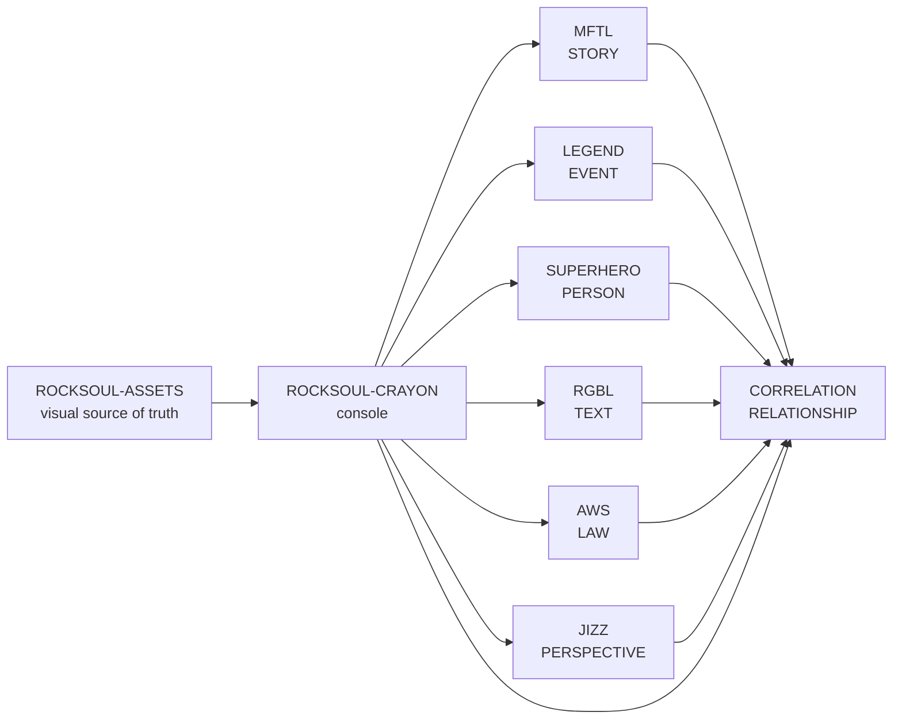
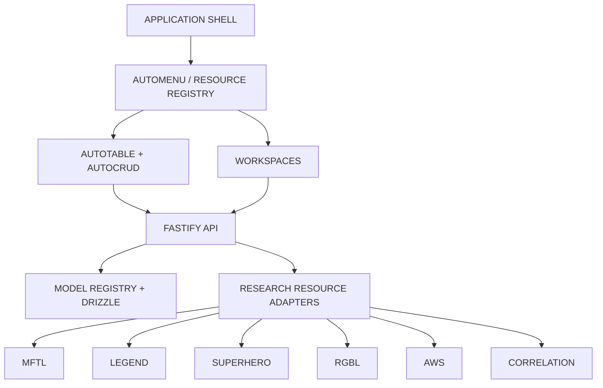

<div align="center">


# ROCKSOUL CRAYON

## **THE CONSOLE**

### **OPERATE THE WHOLE RESEARCH GRAPH FROM ONE PLACE.**

A modular **Fastify + TypeScript operational console** for navigating and working across STORY, EVENT, PERSON, TEXT, LAW, PERSPECTIVE, and the reviewed RELATIONSHIP graph while staying visually aligned with `rocksoul-assets`.


[Architecture](#console-architecture) · [Application Shell](#application-shell) · [Resource Graph](#research-resource-graph) · [Correlation](#correlation-workspace) · [API](#core-api) · [Run](#run-the-console)

</div>

---

> **CRAYON is the operational surface—not the canonical source of STORY, EVENT, PERSON, TEXT, LAW, PERSPECTIVE, or reviewed RELATIONSHIP edges.**

The research repositories own their domain truth. `rocksoul-correlation` owns reviewed public cross-domain edges. CRAYON discovers, navigates, visualizes, orchestrates, and operates those resources through one shared application shell.

## Ecosystem role



| Layer | Repository | Question / role |
|---|---|---|
| **DESIGN** | [`rocksoul-assets`](https://github.com/bjo163/rocksoul-assets) | How should the ecosystem look and behave? |
| **CONSOLE** | **`rocksoul-crayon`** | How do operators work across everything? |
| **STORY** | [`rocksoul-mftl`](https://github.com/bjo163/rocksoul-mftl) | What was told? |
| **EVENT** | [`rocksoul-legend`](https://github.com/bjo163/rocksoul-legend) | What happened? |
| **PERSON** | [`rocksoul-superhero`](https://github.com/bjo163/rocksoul-superhero) | Who was involved? |
| **TEXT** | [`rocksoul-rgbl`](https://github.com/bjo163/rocksoul-rgbl) | What does the exact text say? |
| **LAW** | [`rocksoul-aws`](https://github.com/bjo163/rocksoul-aws) | Was it allowed? |
| **CORRELATION** | [`rocksoul-correlation`](https://github.com/bjo163/rocksoul-correlation) | How do reviewed records relate? |

## Application shell

`rocksoul-assets` is the canonical visual reference for CRAYON. The console should implement its v2 application surfaces rather than inventing a parallel design language.

<div align="center">


</div>

The target shell includes:

```text
DASHBOARD
COMMAND PALETTE
NOTIFICATIONS
KANBAN
CALENDAR
CHAT
AI WORKSPACE
RESOURCES / AUTOMENU
CORRELATION WORKSPACE
PROFILE + SETTINGS
AUTHORIZATION UX
ERROR / EMPTY / LOADING STATES
```

### Dashboard reference

<div align="center">


</div>

### AI workspace reference

<div align="center">


</div>

## Console architecture



### Boundary rule

```text
CRAYON may cache / index / project data for UX.
CRAYON must not silently become canonical ownership for research domains.
CRAYON drafts may become public correlation edges only after review and publication into rocksoul-correlation.
```

Derived tables, search indexes, UI projections, draft hypotheses, and local workspace state remain rebuildable or private implementation artifacts.

## Research resource graph

AutoMenu should expose the six canonical research domains plus the reviewed Relationship layer as first-class resource groups:

```text
RESEARCH
├── Story        → rocksoul-mftl
├── Event        → rocksoul-legend
├── Person       → rocksoul-superhero
├── Text         → rocksoul-rgbl
├── Law          → rocksoul-aws
├── Perspective  → rocksoul-jizz
└── Relationship → rocksoul-correlation
```

Shared console capabilities sit beside them rather than inside one domain:

```text
WORKSPACE
├── Dashboard
├── Search
├── Cases
├── Evidence Graph
├── Correlation Review
├── Tasks / Kanban
├── Calendar
├── Chat
├── AI Workspace
├── Notifications
└── Settings
```

## Research Steward bootstrap topology

The operational Steward contract lives at [`contracts/research-steward-topology.v1.json`](contracts/research-steward-topology.v1.json) with the human-readable plan at [`docs/research-steward-topology.md`](docs/research-steward-topology.md).

Current bootstrap cadence uses all five scheduled intelligence slots every hour:

```text
:00 Ecosystem Bootstrap  → CRAYON
:10 Story-History        → MFTL → reset → LEGEND
:20 Attestation          → RGBL → reset → SUPERHERO
:30 LAW                  → AWS
:40 PERSPECTIVE          → JIZZ

RELATIONSHIP             → Correlation, event-driven
```

The invariant is **SHARE THE CLOCK. NEVER SHARE THE CANONICAL MIND.**

Run `pnpm validate:stewards` to validate the local topology contract.

## Correlation workspace

CRAYON is the operator environment for proposing and reviewing cross-domain edges before publication.

```text
DRAFT HYPOTHESIS
      ↓
FOREIGN REF RESOLUTION
      ↓
SUPPORT + COUNTEREVIDENCE
      ↓
ALTERNATIVE EXPLANATIONS
      ↓
DIMENSION REVIEW
      ↓
HUMAN / POLICY REVIEW
      ↓
PUBLISH
      ↓
rocksoul-correlation
```

The workspace should visualize the canonical dimensions:

`TEMPORAL · GEOGRAPHIC · SEMANTIC · IDENTITY · PROVENANCE`

and preserve the core guardrail:

### **CORRELATION ≠ CAUSATION**

## UI-driven model engine

The existing Model Registry remains the foundation for generic operational resources.

### AutoMenu

`GET /api/v1/models/menu`

Generates the navigation tree from model metadata. Research-domain and correlation adapters should plug into the same navigation grammar instead of hardcoding a second sidebar.

### AutoTable + AutoCRUD metadata

`GET /api/v1/models/:model/metadata`

Supports table columns, badges, avatars, dates, currency, sorting, filtering, forms, validation, relation fields, and model relationships.

### Dynamic CRUD

```text
GET     /api/v1/models/:model
GET     /api/v1/models/:model/:id
POST    /api/v1/models/:model
PUT     /api/v1/models/:model/:id
DELETE  /api/v1/models/:model/:id
```

Generic CRUD remains appropriate for console-owned operational data. Canonical research writes must respect the contracts of the owning repository.

## Repository atlas

```text
rocksoul-crayon/
├── apps/
│   ├── api/                 Fastify API + auth + resource adapters
│   └── web/                 authenticated Rocksoul console
├── packages/
│   ├── common/              shared contracts
│   ├── orm/                 model registry + generic CRUD
│   ├── orm-base/            users / settings / logs
│   ├── orm-project/         projects
│   ├── orm-task/            tasks / kanban
│   ├── orm-calendar/        calendar
│   ├── orm-chat/            conversations
│   ├── orm-mail/            mail / notifications
│   └── ...                  plug-and-play operational modules
├── data/                    local persistence
├── Dockerfile
├── docker-compose.yml
└── pnpm-workspace.yaml
```

## Core API

| Method | Endpoint | Purpose |
|---|---|---|
| `GET` | `/health` | service health |
| `GET` | `/documentation` | Swagger / OpenAPI |
| `POST` | `/api/v1/auth/register` | register |
| `POST` | `/api/v1/auth/login` | login |
| `GET` | `/api/v1/auth/me` | current user |
| `POST` | `/api/v1/auth/api-keys` | create API key |
| `POST` | `/api/v1/auth/logout` | revoke session |
| `GET` | `/api/v1/models` | model introspection |
| `GET` | `/api/v1/models/menu` | AutoMenu tree |
| `GET` | `/api/v1/models/:model/metadata` | UI metadata |
| `GET` | `/api/v1/models/:model` | list/search records |

## Authentication

```text
x-api-key: rs_live_...
Authorization: Bearer <session_token>
```

Authorization UX should follow `rocksoul-assets/moonwitness/ui/v2/26-authorization.svg`.

## Run the console

### Docker

```bash
docker compose up -d --build
docker compose ps
docker compose logs -f
```

### Local development

```bash
pnpm install
pnpm build
pnpm db:generate
pnpm db:seed
pnpm dev
```

## Visual implementation contract

CRAYON should consume, mirror, or faithfully implement:

```text
moonwitness/brand/*
moonwitness/ui/v2/*
moonwitness/icons/*
moonwitness/dashboard-pack/*
moonwitness/data-viz/*
moonwitness/hero-backgrounds/*
moonwitness/state-illustrations/*
moonwitness/motion/*
```

Correlation workspace views should reuse canonical node-link, provenance, evidence-matrix, timeline, repository-health, annotation, and edge-style visual grammar.

---

<div align="center">


## **ONE CONSOLE. SIX RESEARCH DOMAINS. ONE REVIEWED RELATIONSHIP LAYER.**

### **STORY · EVENT · PERSON · TEXT · LAW · PERSPECTIVE · RELATIONSHIP**

`CRAYON / MoonWitness × Rocksoul`

</div>
