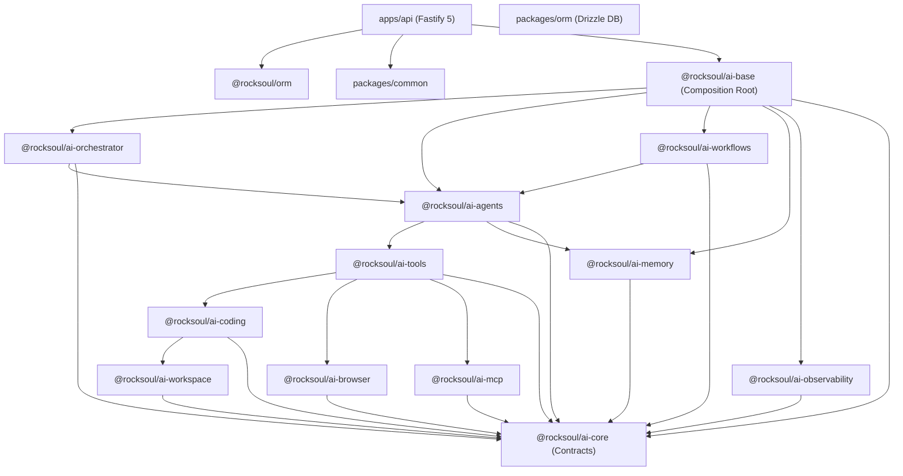

# AI Subsystem Dependency Map

**Project**: Rocksoul Monorepo  
**Phase**: B — Dependency / Workspace Mapping  
**Status**: APPROVED

---

## 1. Monorepo Package Topology

---

## 2. Package Descriptions & Responsibilities

| Package | Purpose | Dependencies |
| :--- | :--- | :--- |
| **`@rocksoul/ai-core`** | Fundamental types, interfaces (`ExecutionContext`, `AgentDefinition`, `ToolDefinition`, `ToolPolicy`, `ModelMessage`, `RunResult`) | *None (Zero internal dependencies)* |
| **`@rocksoul/ai-observability`** | Telemetry, logging adapters for Pino and console, execution metrics | `@rocksoul/ai-core` |
| **`@rocksoul/ai-memory`** | Conversation context storage isolated in `ai.db` | `@rocksoul/ai-core` |
| **`@rocksoul/ai-workspace`** | Sandboxed local file system and project repository access abstraction | `@rocksoul/ai-core` |
| **`@rocksoul/ai-coding`** | Code analysis, diffing, patching, terminal execution sandbox | `@rocksoul/ai-workspace`, `@rocksoul/ai-core` |
| **`@rocksoul/ai-browser`** | Browser automation provider abstraction (Playwright / CDP / Agent Browser) | `@rocksoul/ai-core` |
| **`@rocksoul/ai-mcp`** | Model Context Protocol client and tool registry adapters | `@rocksoul/ai-core` |
| **`@rocksoul/ai-tools`** | Unified tool registry, permission guardrails (`DENY`, `ALLOW`, `ASK_USER`) | `@rocksoul/ai-coding`, `@rocksoul/ai-browser`, `@rocksoul/ai-mcp`, `@rocksoul/ai-core` |
| **`@rocksoul/ai-agents`** | Agent implementations: `assistant` (active), `coder`, `researcher`, `browser`, `supervisor` (foundation) | `@rocksoul/ai-tools`, `@rocksoul/ai-memory`, `@rocksoul/ai-core` |
| **`@rocksoul/ai-workflows`** | Multi-step deterministic AI execution pipelines | `@rocksoul/ai-agents`, `@rocksoul/ai-core` |
| **`@rocksoul/ai-orchestrator`** | Routing, delegation, handoffs, supervisor coordination | `@rocksoul/ai-agents`, `@rocksoul/ai-core` |
| **`@rocksoul/ai-base`** | Composition root and public facade | `@rocksoul/ai-orchestrator`, `@rocksoul/ai-agents`, `@rocksoul/ai-workflows`, `@rocksoul/ai-memory`, `@rocksoul/ai-models`, `@rocksoul/ai-observability`, `@rocksoul/ai-core` |

---

## 3. Circular Dependency Risk Analysis

- **Risk Assessment**: **Zero circular dependencies**.
- **Enforcement Rules**:
  1. `@rocksoul/ai-core` never imports from any sibling `ai-*` package.
  2. Sub-capabilities (`ai-browser`, `ai-coding`, `ai-mcp`, `ai-workspace`, `ai-memory`, `ai-observability`) only depend on `ai-core`.
  3. `ai-tools` aggregates capabilities and presents a normalized interface to `ai-agents`.
  4. `ai-agents` does NOT import `ai-orchestrator` or `ai-workflows`.
  5. `ai-base` is strictly an egress composition root and is NEVER imported by any package in `packages/ai/*`.
  6. `apps/api` only imports `@rocksoul/ai-base` and `@rocksoul/ai-core`.
