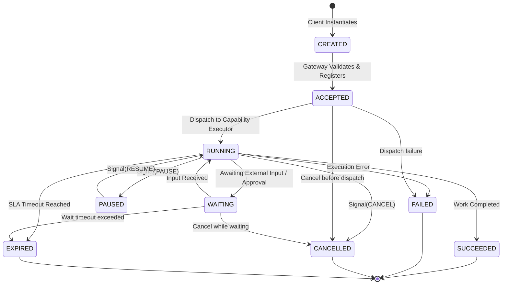

# Execution Constitution, Identity & Lifecycle Model
**Application Execution Protocol (AEP)**
*Specification Version: 1.1.0-normative*

---

## 1. The Execution as the Universal Primitive

In AEP, all application operations are modeled as an **Execution**. Request/response is merely a special degenerate case of an execution with a single immediate output.

Examples of Operations as Executions:
- `project.search`: Read-only query execution yielding a single result.
- `task.assign`: Mutating execution with idempotent SQLite persistence.
- `ai.ask`: Streaming multi-event execution with token deltas and tool invocations.
- `browser.navigate`: Interactive execution with DOM snapshots and screenshot events.
- `coding.patch`: Workspace execution producing file diffs and artifact manifestations.
- `workflow.run`: Composite parent execution orchestrating multiple child executions.

---

## 2. Execution Source of Truth: `execution_records`

### 2.1 Clear Architectural Boundary
The SQLite table `execution_records` is strictly an **Application Execution Ledger**. It is:
- **NOT** a replacement for existing domain tables (`users`, `projects`, `tasks`, `conversations`, `mails`).
- **NOT** AI context storage (which resides in the isolated Rocksoul AI memory subsystem).
- **NOT** an ephemeral protocol cache.

```text
┌─────────────────────────────────────────────────────────────┐
│                 AEP Gateway & Runtime                       │
└──────────────────────────────┬──────────────────────────────┘
                               │
            ┌──────────────────┴──────────────────┐
            ▼                                     ▼
┌───────────────────────────────┐   ┌─────────────────────────┐
│       execution_records       │   │  Canonical Domain Tables│
│ (Application Execution Ledger)│   │ (tasks, projects, mails)│
├───────────────────────────────┤   ├─────────────────────────┤
│ - executionId (PK)            │   │ - id (PK)               │
│ - actorId                     │   │ - title / name / body   │
│ - capabilityId                │   │ - status / priority     │
│ - idempotencyKey              │   │ - foreign relations     │
│ - status (ACCEPTED..SUCCEEDED)│   │                         │
│ - targetResourceType ('task') │───┼─► References Canonical  │
│ - targetResourceId ('t_123')  │   │   Domain Entity ID      │
│ - createdAt / completedAt     │   │                         │
│ - resultSummary / errorCode   │   │                         │
└───────────────────────────────┘   └─────────────────────────┘
```

### 2.2 Relational Invariants
1. **Zero Domain Duplication**: `execution_records` never duplicates entity attributes (e.g. `task.title`, `project.description`). It references entities exclusively via `targetResourceType` and `targetResourceId`.
2. **Authoritative Domain Ownership**: Domain entities remain owned and validated by existing services and Drizzle ORM schemas.
3. **Audit Trail**: Every domain state mutation is auditable back to the exact `executionId`, `actorId`, and `causationId` that produced it.

---

## 3. Disambiguation of Execution Identity Tuple

To prevent conflation between executions, attempts, requests, and deduplication keys, AEP defines the exact role and lifecycle of each field:

| Field | Conceptual Role | Created By | Lifespan & Immutability | Re-sent on Retry? |
|---|---|---|---|---|
| **`executionId`** | **The Logical Work Unit** | Client at creation | **Immutable** across all retries, reconnects, and attempts. | YES (Identical) |
| **`requestId`** | **The Network Attempt** | Client at wire dispatch | **Ephemeral per physical attempt**. If a frame times out and is resent, a **NEW** `requestId` is generated. | NO (New per retry) |
| **`idempotencyKey`** | **The Mutation Deduplication Key** | Client caller | **Immutable**. Used by SQLite unique index to collapse concurrent or retried requests into 1 execution. | YES (Identical) |
| **`parentExecutionId`** | **Hierarchical Workflow Link** | Runtime / Agent | Optional link to enclosing parent execution (e.g. Agent Run). | YES (Inherited) |
| **`causationId`** | **Causal Predecessor Link** | Dispatcher | Links execution to the triggering event, message, or user action. | YES (Immutable) |
| **`sessionId`** | **Actor Session Context** | Handshake | Active session under which execution was requested. | Resumed if session alive |
| **`actorId`** | **Authorized Principal** | Session context | The authenticated user or system identity executing the work. | Immutable |
| **`capabilityId`** | **Target Function / Operation** | Caller | The registered operation invoked (e.g. `task.assign`). | Immutable |

### 3.1 Non-Conflation Rule: `executionId` vs. `requestId` vs. `idempotencyKey`
- $N$ physical attempts (`requestId_1, requestId_2, ...`) $\longrightarrow$ 1 logical execution (`executionId`) $\longrightarrow$ 1 business effect (`idempotencyKey`).
- A client must **never** reuse `requestId` when retransmitting a dropped request; `requestId` uniquely traces the physical network transit in telemetry.

---

## 4. Canonical 9-State Execution Lifecycle



---

## 5. Formal State Transition Matrix

The execution state machine enforces strict fail-closed transitions:

| From \ To | `CREATED` | `ACCEPTED` | `RUNNING` | `WAITING` | `PAUSED` | `SUCCEEDED` | `FAILED` | `CANCELLED` | `EXPIRED` |
|---|---|---|---|---|---|---|---|---|---|
| **`CREATED`** | ❌ | ✅ (Register) | ❌ | ❌ | ❌ | ❌ | ✅ (Client err) | ✅ (Client abort) | ❌ |
| **`ACCEPTED`**| ❌ | ❌ | ✅ (Dispatch) | ❌ | ❌ | ❌ | ✅ (Dispatch err)| ✅ (Cancel) | ✅ (Queue timeout)|
| **`RUNNING`** | ❌ | ❌ | ❌ | ✅ (Need input)| ✅ (Pause)| ✅ (Complete) | ✅ (Error) | ✅ (Cancel) | ✅ (SLA timeout) |
| **`WAITING`** | ❌ | ❌ | ✅ (Resume) | ❌ | ❌ | ❌ | ✅ (Error) | ✅ (Cancel) | ✅ (Wait timeout)|
| **`PAUSED`**  | ❌ | ❌ | ✅ (Resume) | ❌ | ❌ | ❌ | ✅ (Error) | ✅ (Cancel) | ✅ (Pause timeout)|
| **`SUCCEEDED`** *(Terminal)* | ❌ | ❌ | ❌ | ❌ | ❌ | ❌ | ❌ | ❌ | ❌ |
| **`FAILED`** *(Terminal)* | ❌ | ❌ | ❌ | ❌ | ❌ | ❌ | ❌ | ❌ | ❌ |
| **`CANCELLED`** *(Terminal)* | ❌ | ❌ | ❌ | ❌ | ❌ | ❌ | ❌ | ❌ | ❌ |
| **`EXPIRED`** *(Terminal)* | ❌ | ❌ | ❌ | ❌ | ❌ | ❌ | ❌ | ❌ | ❌ |

### 5.1 Terminal State Invariant (P024)
Once an Execution reaches `SUCCEEDED`, `FAILED`, `CANCELLED`, or `EXPIRED`, its state is **strictly immutable**. Any subsequent `DATA`, `RUN`, or `SIGNAL` targeting that `executionId` is rejected with `EXECUTION_TERMINAL_STATE`.
