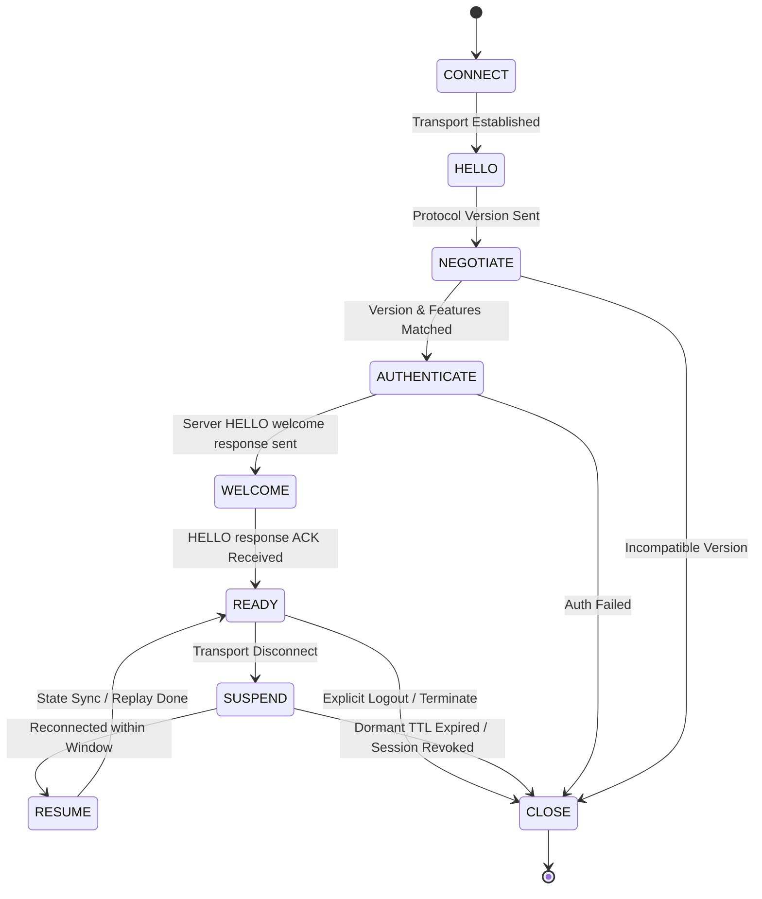

# Session Constitution & State Machine
**Application Execution Protocol (AEP)**
*Specification Version: 1.1.0-normative*

---

## 1. Connection vs. Session Separation

A foundational principle of AEP is the decoupling of **Transport Connection** from **Application Session**:

```text
┌─────────────────────────────────────────────────────────────┐
│                     APPLICATION SESSION                     │
│  sessionId: "ses_01j9x...", identity: "usr_admin",         │
│  activeExecutions: [exe_1, exe_2], seq: 142                 │
└─────────────────────────────────────────────────────────────┘
          │                                         │
   (Physical drop)                           (Reconnect)
          ▼                                         ▼
┌───────────────────┐                     ┌───────────────────┐
│   CONNECTION 1    │                     │   CONNECTION 2    │
│  WebTransport #1  │                     │   WebSocket #1    │
│ [DISCONNECTED ❌] │                     │   [CONNECTED ✅]  │
└───────────────────┘                     └───────────────────┘
```

1. **Connection**: Ephemeral network carrier (TCP socket, WebTransport session, QUIC connection). Connection drop does **NOT** equal Session termination.
2. **Session**: Authoritative client state maintained on the server within a configurable dormant TTL (Default: `24 hours`). The separate `60 seconds` window governs only in-memory frame replay, never session validity.

---

## 2. Canonical Session Lifecycle States

The Session State Machine comprises exactly nine formal states:



### 2.1 State Definitions
1. **`CONNECT`**: Client is opening physical transport socket (WebTransport / WebSocket).
2. **`HELLO`**: Client has transmitted `HELLO` frame carrying protocol version, supported serializers, and client metadata.
3. **`NEGOTIATE`**: Server matches highest compatible protocol version and serialization codec.
4. **`AUTHENTICATE`**: Server evaluates provided bearer session token or API key against SQLite `user_sessions` / `api_keys`.
5. **`WELCOME`**: A semantic handshake state, not an eighth protocol primitive. The server emits a `HELLO` frame on Stream 0 with `helloKind: "WELCOME"`, `sessionId`, negotiated capabilities, and server time.
6. **`READY`**: Fully operational bi-directional state. Streams, executions, and data frames flow.
7. **`SUSPEND`**: Transport connection dropped unexpectedly. Server preserves session, buffers critical events, and pauses non-essential execution streams.
8. **`RESUME`**: Client reconnects with a Stream-0 `HELLO` carrying `RESUME_REQUEST`, `sessionId`, `resumeToken`, and `lastAcknowledgedSequence`. The server returns `HELLO(helloKind: "WELCOME")` whose `resume.status` is `ACCEPTED` or `REJECTED`.
9. **`CLOSE`**: Terminal state. Session invalidated, resources released, in-flight non-persistent executions terminated.

---

## 3. Comprehensive Session Transition Matrix

| From State \ To State | CONNECT | HELLO | NEGOTIATE | AUTHENTICATE | WELCOME | READY | SUSPEND | RESUME | CLOSE |
|---|---|---|---|---|---|---|---|---|---|
| **CONNECT** | ❌ | ✅ | ❌ | ❌ | ❌ | ❌ | ❌ | ❌ | ✅ (fail) |
| **HELLO** | ❌ | ❌ | ✅ | ❌ | ❌ | ❌ | ❌ | ❌ | ✅ (abort) |
| **NEGOTIATE** | ❌ | ❌ | ❌ | ✅ | ❌ | ❌ | ❌ | ❌ | ✅ (reject) |
| **AUTHENTICATE**| ❌ | ❌ | ❌ | ❌ | ✅ | ❌ | ❌ | ❌ | ✅ (401) |
| **WELCOME** | ❌ | ❌ | ❌ | ❌ | ❌ | ✅ | ✅ (drop) | ❌ | ✅ (err) |
| **READY** | ❌ | ❌ | ❌ | ❌ | ❌ | ❌ | ✅ (drop) | ❌ | ✅ (logout) |
| **SUSPEND** | ❌ | ❌ | ❌ | ❌ | ❌ | ❌ | ❌ | ✅ (recon) | ✅ (timeout)|
| **RESUME** | ❌ | ❌ | ❌ | ❌ | ❌ | ✅ (sync) | ✅ (fail) | ❌ | ✅ (reject) |
| **CLOSE** *(Terminal)*| ❌ | ❌ | ❌ | ❌ | ❌ | ❌ | ❌ | ❌ | ❌ |

*Legend: ✅ = Legal transition | ❌ = Illegal transition (must be rejected immediately).*
