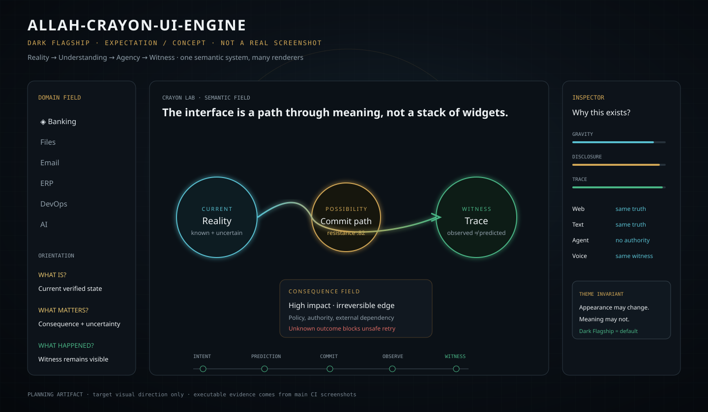
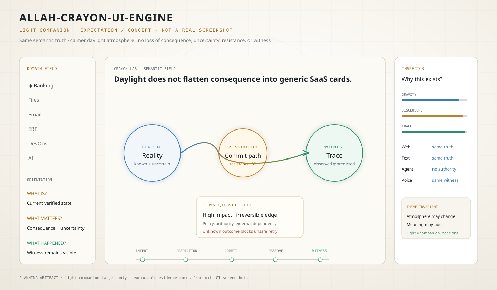

# CRAYON Showcase Concepts

Generated visual concepts are planning artifacts, not screenshots of the executable CRAYON Lab.

## EXPECTATION / CONCEPT — Dark Flagship

This board explores the flagship midnight/gold/cyan/witness visual language and a semantic field where current reality, possibility, consequence, resistance, and witness remain connected rather than becoming unrelated dashboard cards.

## EXPECTATION / CONCEPT — Light Companion

The companion keeps the same semantic path and Inspector hierarchy while changing atmosphere to warm ivory/pearl surfaces suitable for daylight, enterprise, documentation, and print-oriented contexts.

## Purpose

Concept imagery explores the target visual language for:

- Dark Flagship identity;
- Light Companion identity;
- semantic flow instead of generic dashboard composition;
- consequence-before-commitment;
- witness trace and evidence chronology;
- Web / Text / Agent / Voice parity;
- multi-domain representation.

## Truthfulness rule

Every planning/generated visual included in this repository must be labeled **EXPECTATION / CONCEPT**. Real screenshots must be labeled **REAL LAB BUILD** and must come from executable code.

Concepts may guide implementation, but documentation must never imply that a generated or hand-authored planning board is evidence that the executable Lab already matches it.

## Real proof lives elsewhere

The executable Lab screenshot paths are documented in the repository README and are populated by the `living-crayon` workflow only after a green `main` verification. `v0.8.0-alpha.2` captures the same Banking scenario in both Dark Flagship and Light Companion so the visual difference can be evaluated without changing semantic input.

## Current target

The target direction is a calm semantic field with visible paths between current reality, possibility, consequence, commitment resistance, predicted future, observation, and witness. Panels are permitted where they support inspection, but the primary representation should not collapse back into a conventional component dashboard.

The Lab should converge toward this direction through deterministic renderer behavior and visual-theme tokens rather than image imitation.
